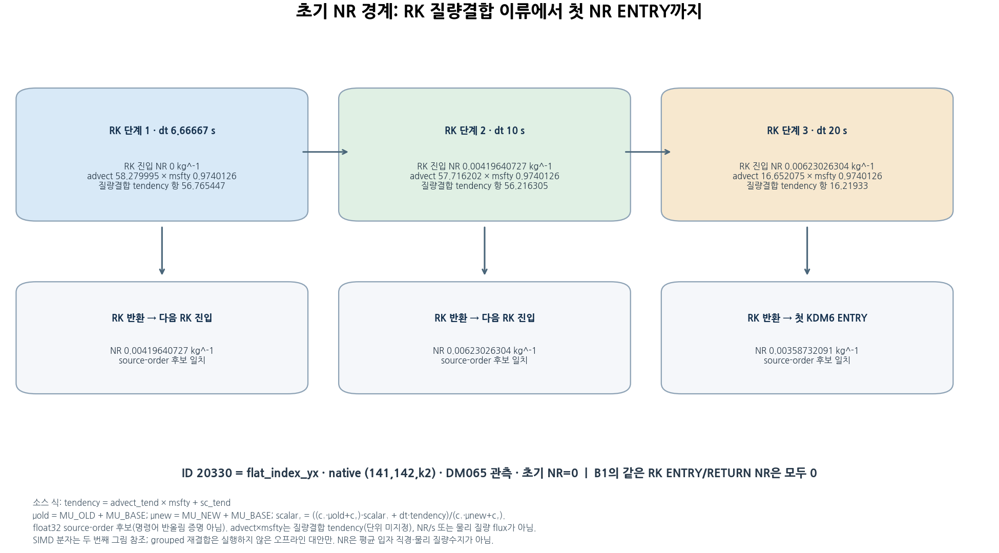
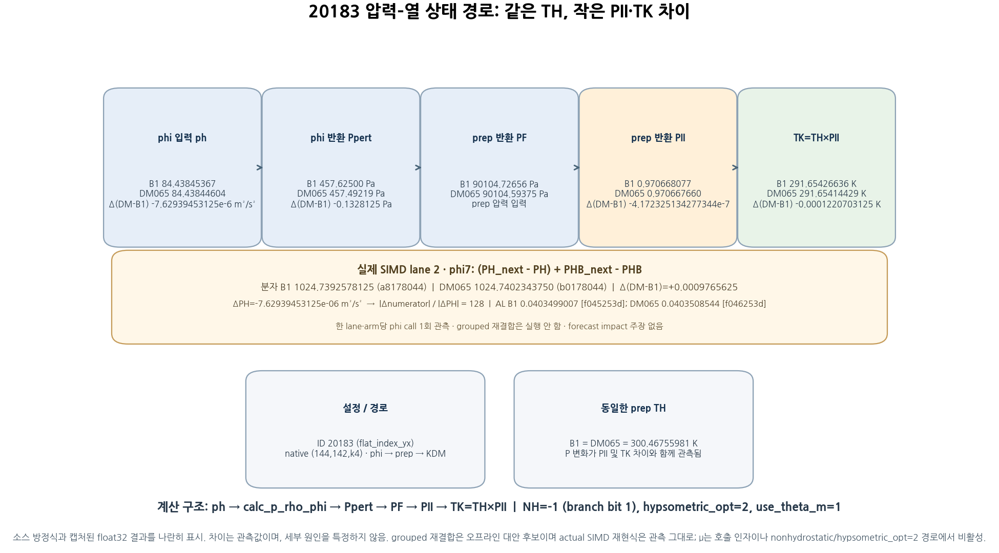

# CP02 초기 경계 메커니즘 그림

두 그림은 고정된 분석 JSON과 sourcepins를 검증한 뒤 생성했습니다.

## 20330, k=2: 초기 NR, RK3 질량결합 이류 항, 단계별 첫 ENTRY/반환 연결.

## ID 20183 (flat_index_yx): phi → prep → KDM 경로와 실제 lane-2 SIMD 분자 관측.

## 검증된 입력 SHA-256

- `B1 numerator stream`: `22c4f973cce3a84611a1094cbeb34aceccb8ad93875f8e7fe2ec48ebd2b5e3d5`
- `B1 receipt`: `8fa8cfdc075a6e3ba941572b93ae156cf5268576180cc8a034327a1b6afc3992`
- `DM065 numerator stream`: `c92998e180c439e51e577e875df6faadcc18079e3b0e2acfe4283815fb209fd7`
- `DM065 receipt`: `88a217d936f8ee98c39bc2a954e44b81cf3e0268431009b61063897fdf416a0c`
- `closure`: `15a5ffdde46d24358af3d9815fa7ff0a63d9bf4ce381cbffa1e0df6ee9f6c300`
- `font`: `48a28e97b34fc8e5b157657633670cd1b7de126cfc414da65ce9c3d5bc8be733`
- `module_big_step_utilities_em.f90`: `d8c11bd9b3dd0fd717c14899c53ffe7ca37c4d768128c4dac750429f7fb4bf3a`
- `module_em.f90`: `e00d4b4131e179c2e59aa2cf282965bed1aef5c449202405e93b2e43e8e9e804`
- `module_first_rk_step_part1.f90`: `67ecbdc5865bdc7fabd2b879f3e588e041d57a78b6938ee7ea774bb45738f77a`
- `module_microphysics_driver.f90`: `149e11e0dc678600f189bd5fb66c190b6253b0663b253d211d929d8b17b0cddc`
- `module_small_step_em.f90`: `a6f4b9243e83e40dd356920d5d92b89fb72233541613eaab197ff3c45b4028d9`
- `phi analysis`: `47bd19bf23651971ed63f27f13a4a9b8553f7d366771134d7811bcaee794dcc4`
- `solve_em.f90`: `4e1c09c342c9a6382d08a02f7944ada74d5f5b54ba3fca49062bfd628825aaf9`
- `source manifest`: `9bac690cbe8ec7ad32ea4bd5057fdf6fcb3e86c599c279b5758f2f7e145c41cb`
- `writer analysis`: `81136f351c4804be078761cbfc57a715ccd58bf24ffd1537cb4c180a1b3d475b`
