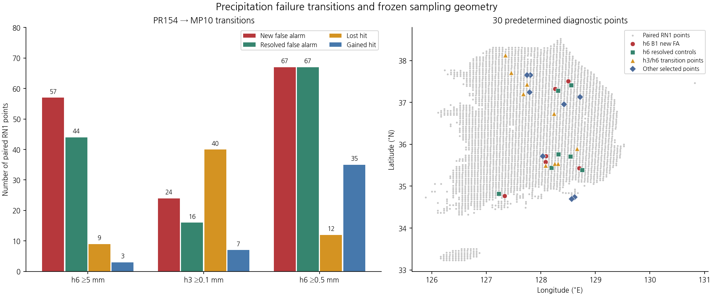
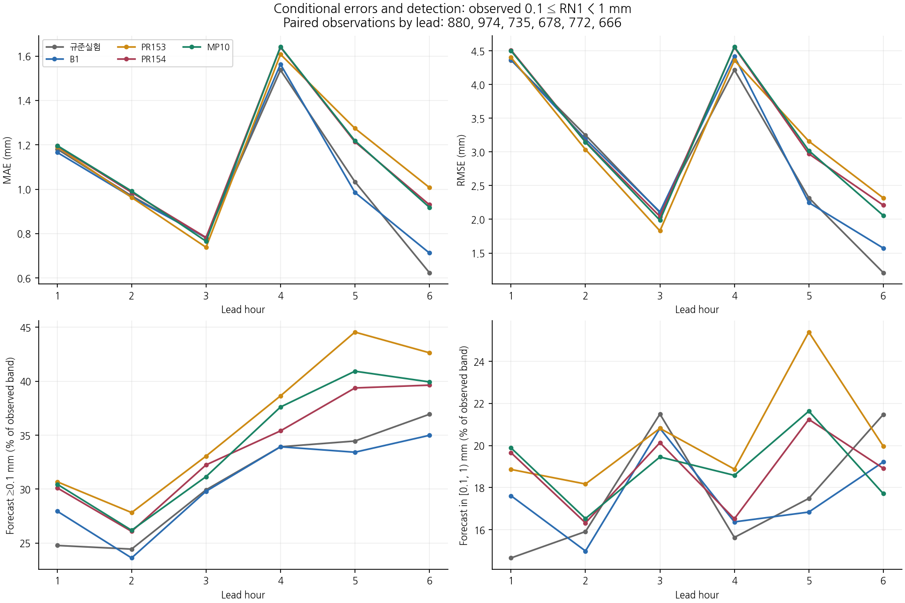
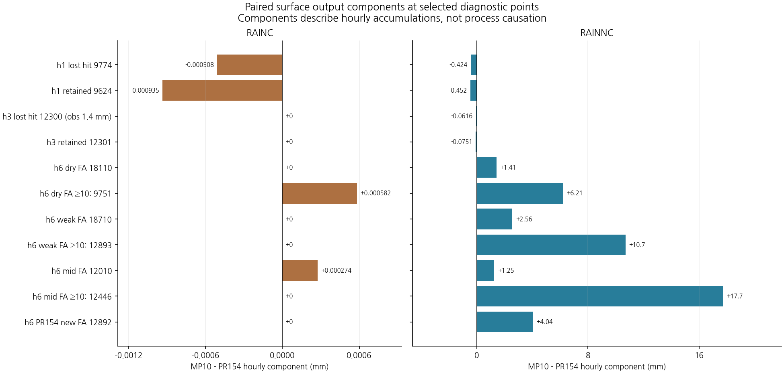
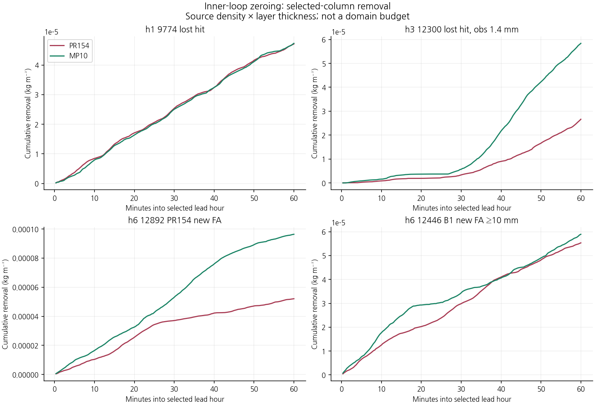
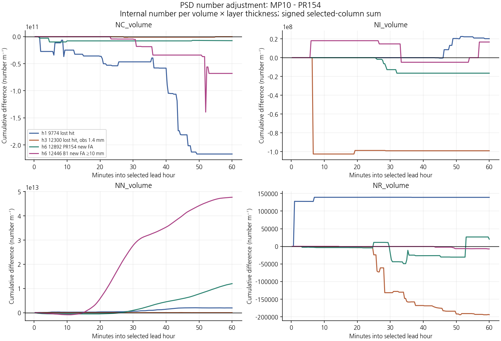
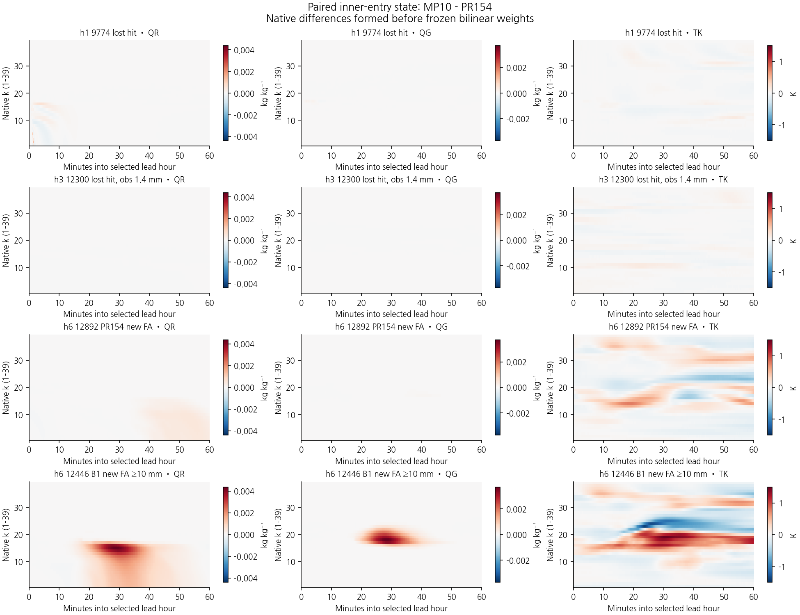
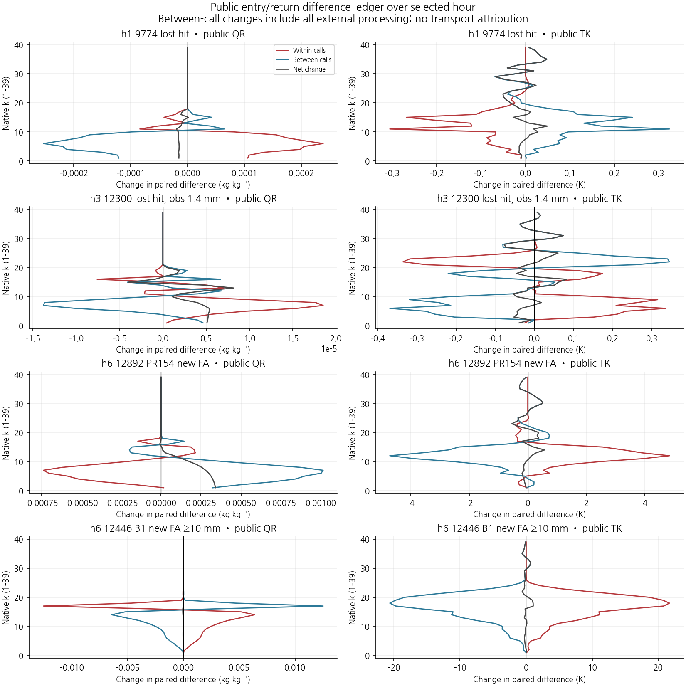

# MP10 내부 반복과 오경보: 그림 모음

[학술 보고서](../../CP02_MP10_PROCESS_20261110.md) · 묶음 파일: `all_figures.zip` · [모든 시간·임계값의 전체 점수](../cp02_pulse_path_20261110/evaluation/results/FULL_SCORES.md)

MP10은 22/26으로 미채택이며 현재 B1을 유지한다. 이번 진단 재적분은 두 구성의 기존 정시 history 14개를 그대로 재현한다. 30점은 과정 진단 집단이며 독립 기상 사례가 아니다.

## MP10 실제 내부 반복과 실패 지점의 과정 진단

### 실패·해소 전이와 계측 지점

### 실제 약한 관측 강수의 검출·강도·조건부 오차

### 같은 지점의 RAINC·RAINNC 차이

### 내부 반복의 미량 수상량 제거

### PSD·수농도 조정의 부호 있는 변화

### 진입 비·싸락눈·기온의 시간–층 차이

### 호출 내부·호출 사이 상태 장부

