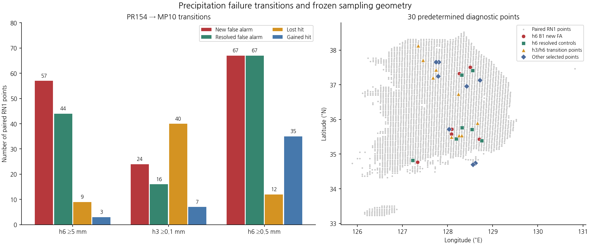
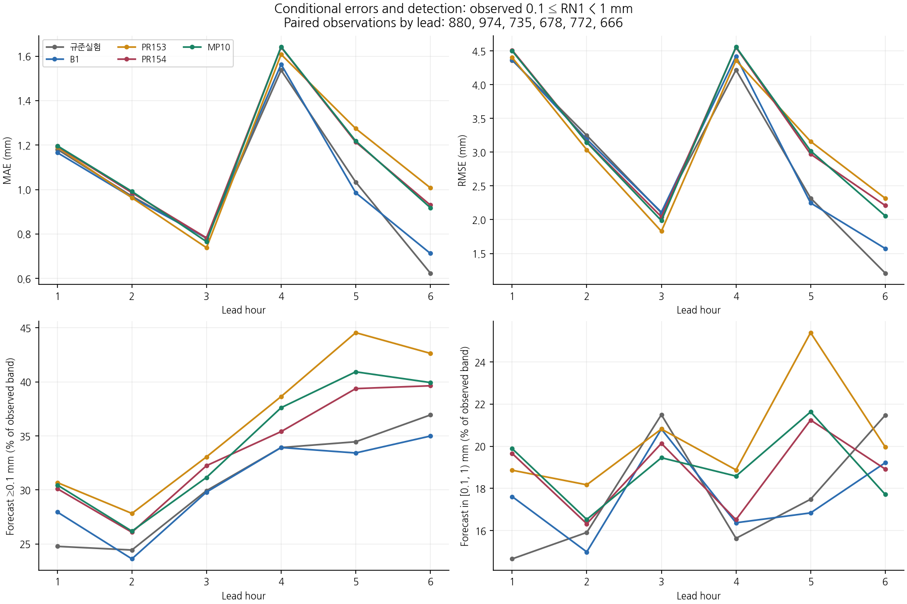
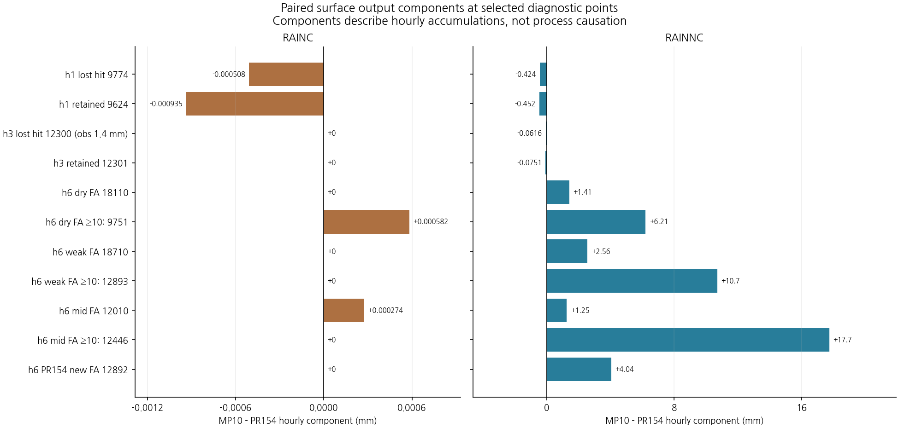
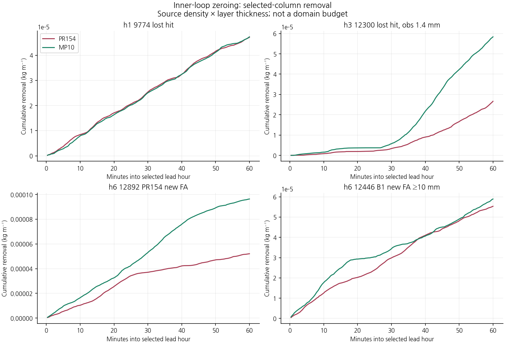
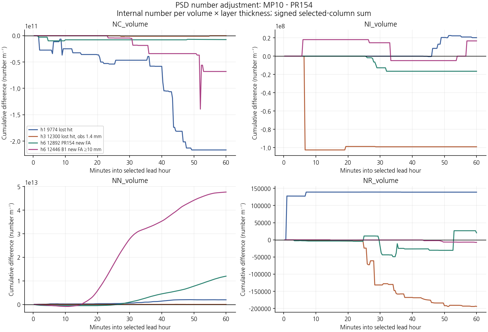
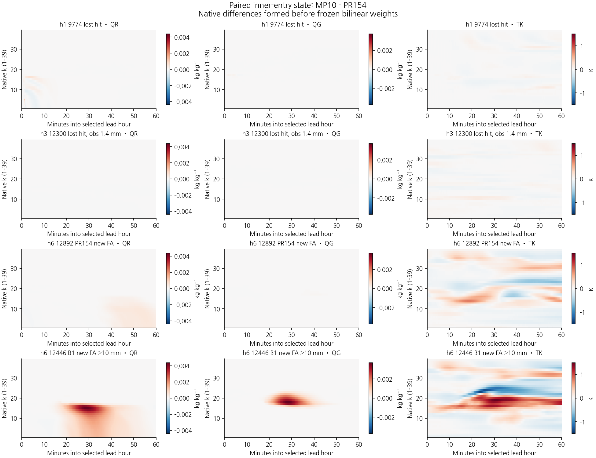
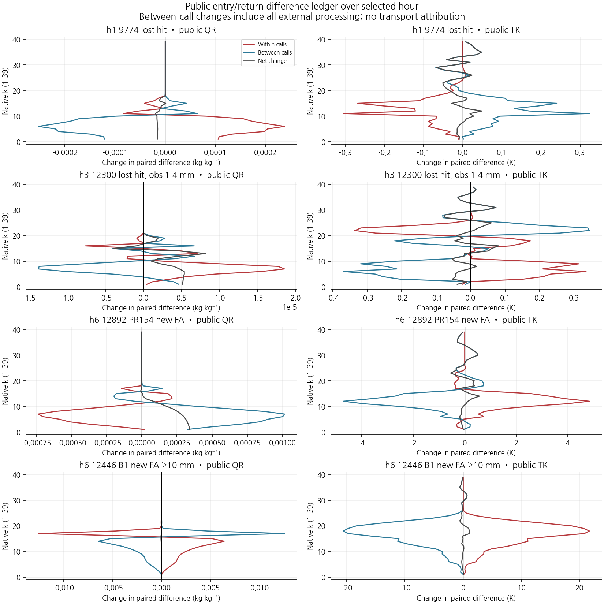

# MP10 diagnostic figure gallery

The 30 diagnostic points and bilinear weights were fixed from the sealed prior evaluation. The fixed forecast admission result remains 22/26; B1 is retained.

| Figure | View | Full plotted values |
|---|---|---|
| [Transition counts and selected-point geography](01_transition_geometry.png) |  | [selected_points.csv](selected_points.csv), [transitions.csv](transitions.csv) |
| [Weak-observation errors and detection by lead](02_weak_conditional.png) |  | [weak_conditional_errors.csv](weak_conditional_errors.csv) |
| [Hourly RAINC and RAINNC contrasts](03_surface_components.png) |  | [point_components.csv](point_components.csv) |
| [Actual zeroing removal at selected columns](04_cleanup_removal.png) |  | [04_cleanup_values.csv](04_cleanup_values.csv) |
| [Signed internal PSD number changes](05_psd_number_adjustment.png) |  | [05_psd_values.csv](05_psd_values.csv) |
| [Native-level QR, QG and temperature contrasts](06_state_contrasts.png) |  | [06_state_values.csv](06_state_values.csv) |
| [Public local and between-call differences](07_public_ledger.png) |  | [07_public_ledger_values.csv](07_public_ledger_values.csv) |

Observed weak rain means 0.1 ≤ RN1 < 1 mm. Point 12300 has observed 1.4 mm and is not in that weak band.

Native k is a model level index, not altitude. Selected-column values use frozen bilinear weights; they are not a domain budget. Internal number per volume is kept separate from public number mixing ratios.

RAINC/RAINNC are stored output components, and between-call changes include all external processes; neither by itself identifies a physical cause.
