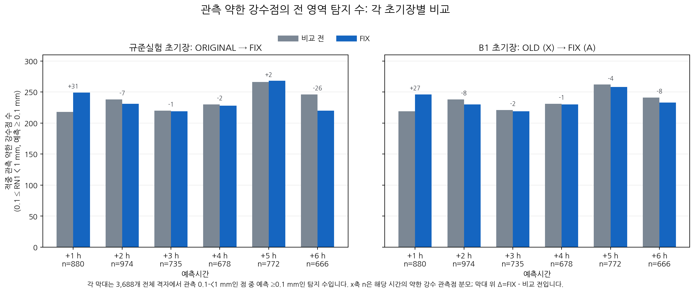
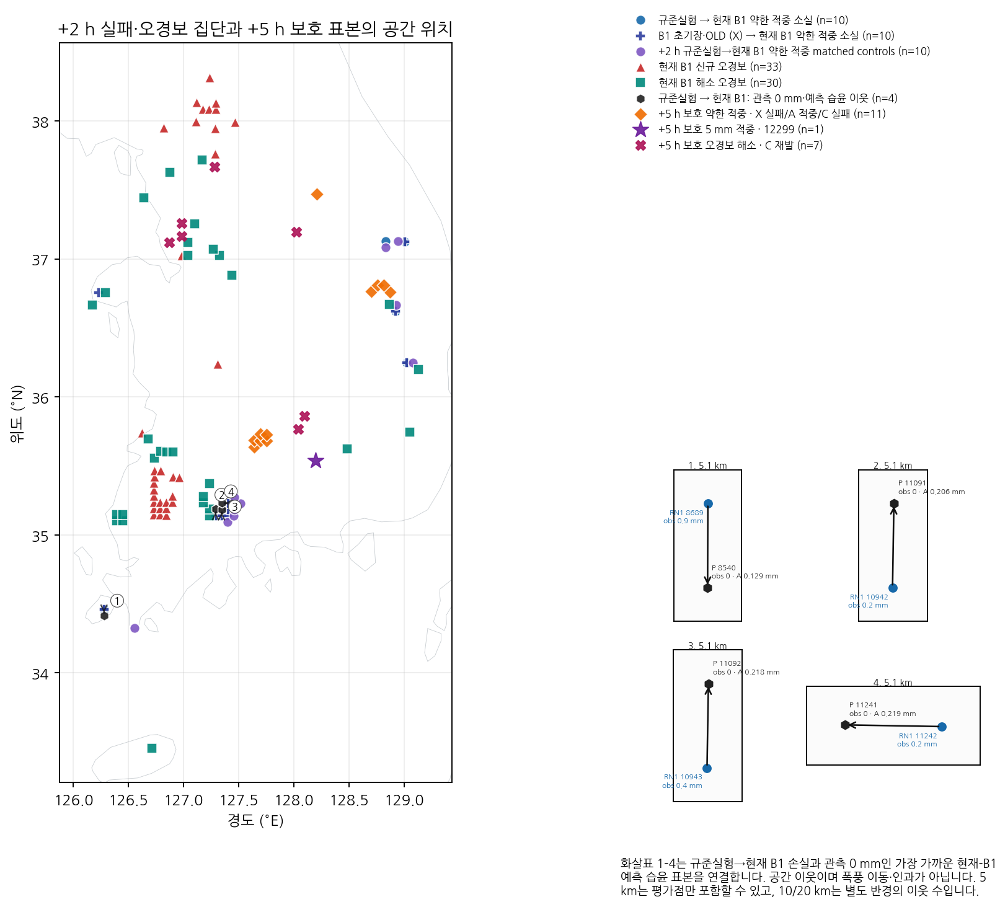
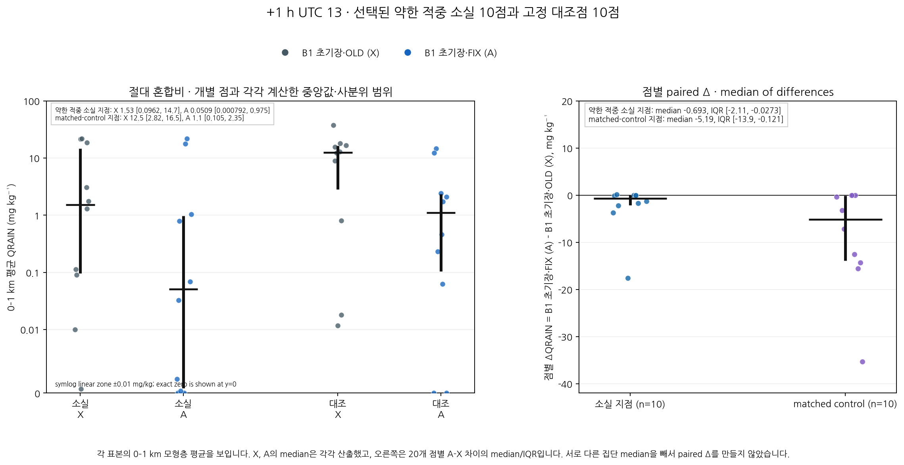
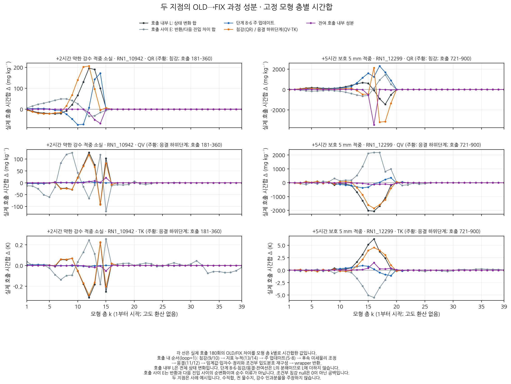

# 보고서 그림 모음

같은 B1 초기장의 OLD/FIX를 비교합니다. 규준실험은 ORIGINAL이며, X는 B1 초기장·OLD, A는 현재 B1·FIX입니다. 새 후보 채택이나 성능 개선을 추가한 자료가 아닙니다.

[학술 형식 보고서](../../CP02_PROTECTED_PROCESS_20261106.md) · [시간·임계값별 전체 점수](tables/FULL_SCORES.md) · [그림 묶음 ZIP](all_figures.zip)

## 그림 1. 동일 초기장의 예보시간별 실제 약한 강수 검출

실제 약한 관측 구간은 0.1≤RN1<1 mm, 검출은 예측≥0.1 mm다. 시간이나 임계값을 평균하지 않는다.

## 그림 2. 실패·보호 집단과 인접 오경보의 위치

OA와 XA 소실 집단을 구분한다. 신규·해소 오경보 33·30은 X→A 비교다. 화살표는 공간 이웃 대응이며 강수계 이동 경로가 아니다.

## 그림 3. 하층 비 혼합비의 원래 양·남은 양과 지점별 차이

0–1 km 모형층 산술평균 뒤 공간 보간한 진단이다. 질량 평균이 아니며 중앙값의 차이와 차이의 중앙값을 구분한다.

## 그림 4. 실제 호출 경계의 고정 모형층별 과정 비교

RN1_10942의 +2시간과 RN1_12299의 +5시간이다. 호출 내부 L과 그 분해항을 중복 합산하지 않는다. E는 호출 사이 전체 순변화이며 순수 이류가 아니다.

## 이전 보존 그림

[PR151 그림 5장 모음](../cp02_failure_focus_20261105/figures/gallery.md)은 기존 경로에 그대로 보존했습니다.
