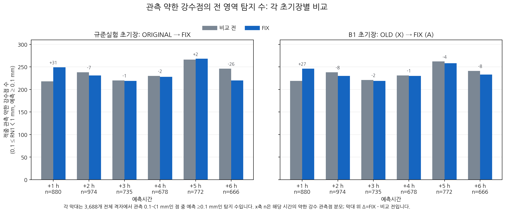
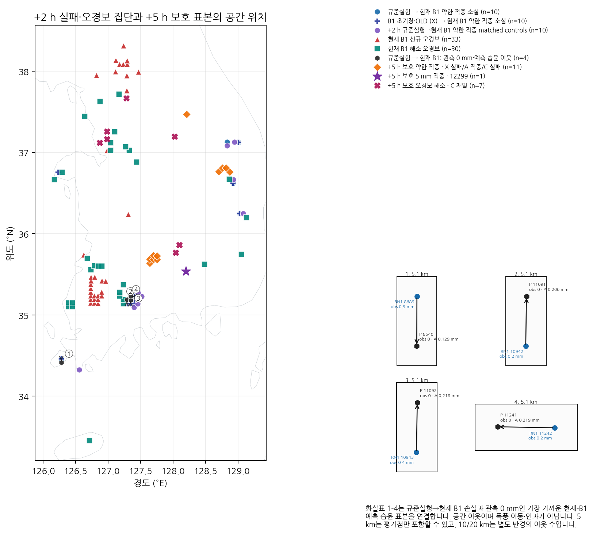
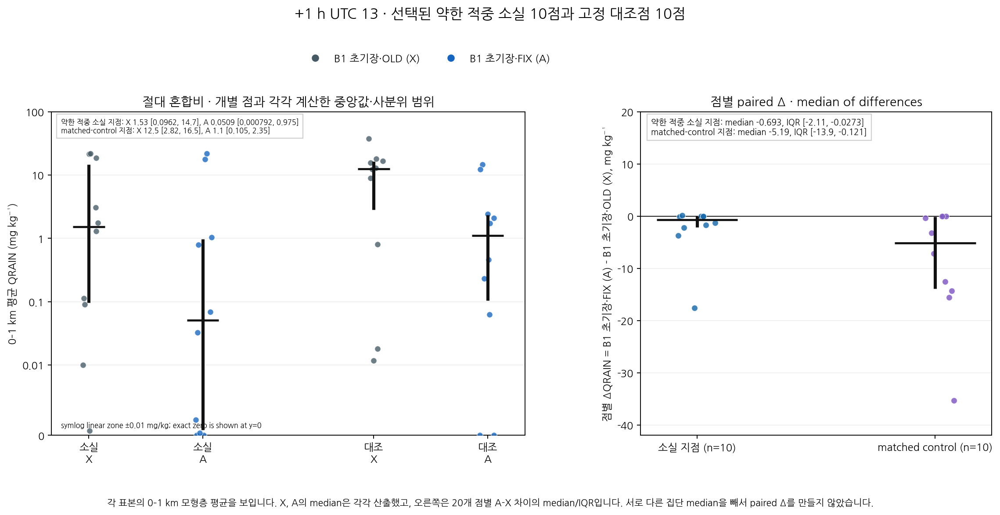

# CP02 보호·실패 과정 진단 그림

이 그림은 고정 2026-08-16 사례의 점수·표본 통계와 밀봉된 상태 표를 요약합니다. 공간 연관은 storm motion이 아니며, 점별 차이는 과정 인과나 전체 물·에너지 수지를 입증하지 않습니다.

## 전체 3,688 격자에서 관측 약한 강수(0.1≤RN1<1 mm) 중 예측 ≥0.1 mm 탐지 수. 막대 위 Δ와 시간별 약한 관측 분모를 표시합니다.

## 고정 약한 적중 실패·대조·오경보 집단과 +5 h 보호 표본. 네 화살표는 OA 손실과 관측 0인 예측 습윤 이웃의 공간 관계입니다.

## UTC 13의 0–1 km QRAIN 절대값과 점별 paired A-X. 절대값은 symlog 축에서 exact zero를 포함합니다.

