# 강수 급증과 내부 시간분할: 그림 모음

[전체 보고서](../../CP02_PULSE_PATH_AND_SUBSTEPS_20261110.md) · [전체 점수표](evaluation/results/FULL_SCORES.md)

MP10은 26개 조건 중 22개를 충족해 채택되지 않았으며 B1을 유지한다. 과정 진단은 선택 사례의 분석이고, 시간분할 실험은 전체 미세물리 연산에 대한 수치 민감도다.

## 급증의 과정 분석

### 지상 누적 강수

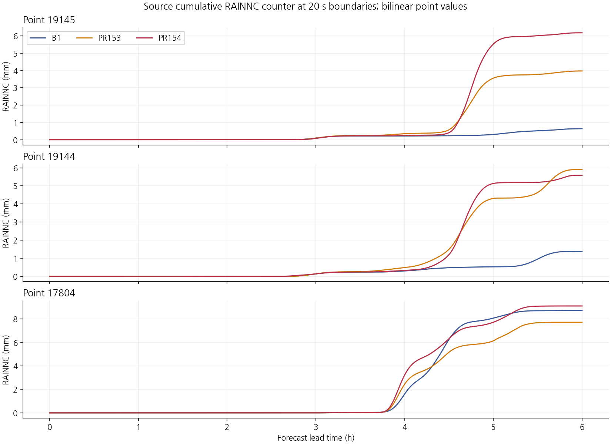

### 5분 강수 급증의 시간 변화

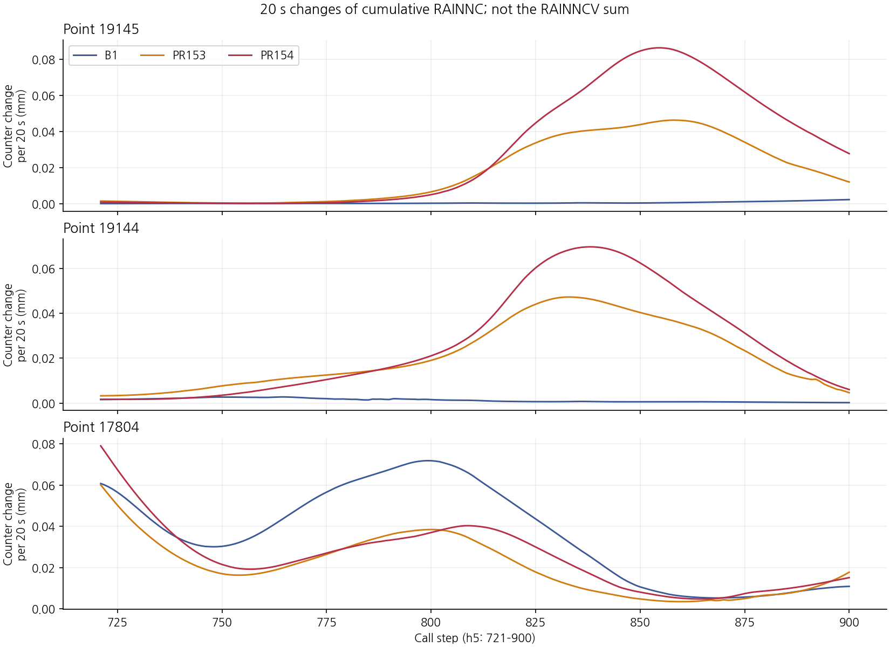

### PR153−B1 비 혼합비

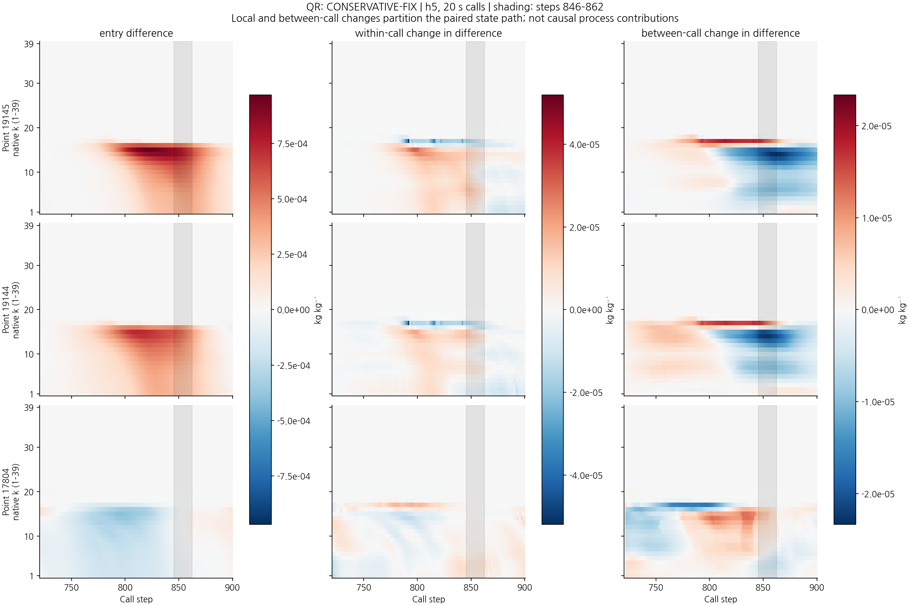

### PR153−B1 싸락눈 혼합비

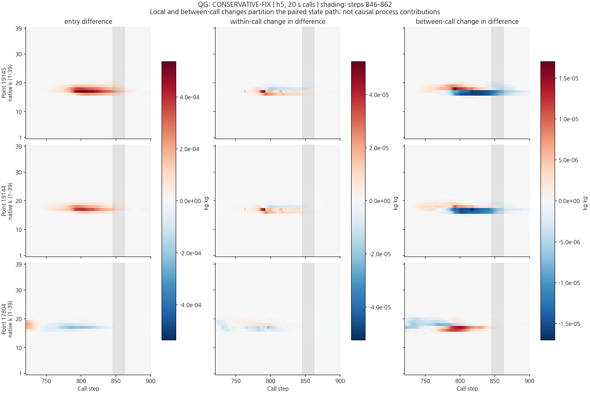

### PR154−PR153 비 혼합비

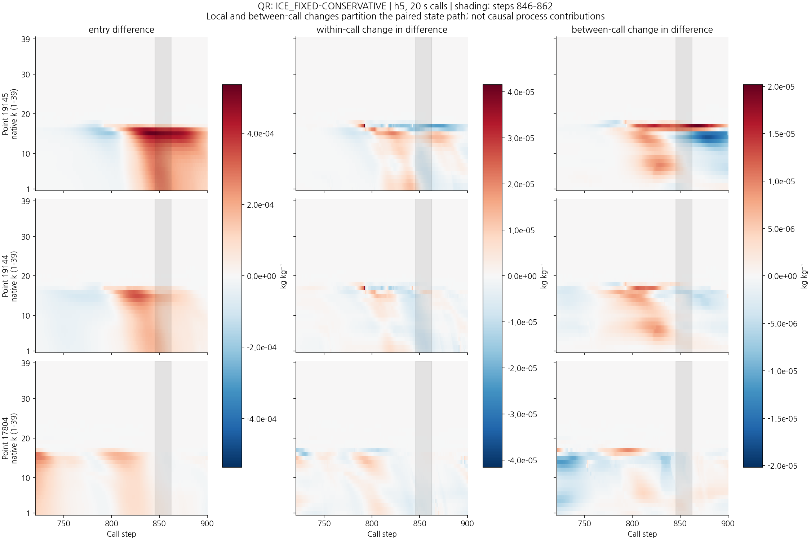

### PR154−PR153 싸락눈 혼합비

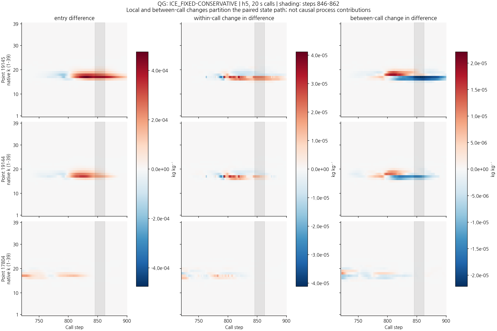

### 급증 전 싸락눈 성장 항

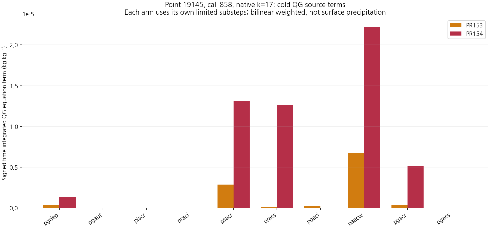

## 후보의 점수와 비교

### 시간과 임계값별 CSI 차이

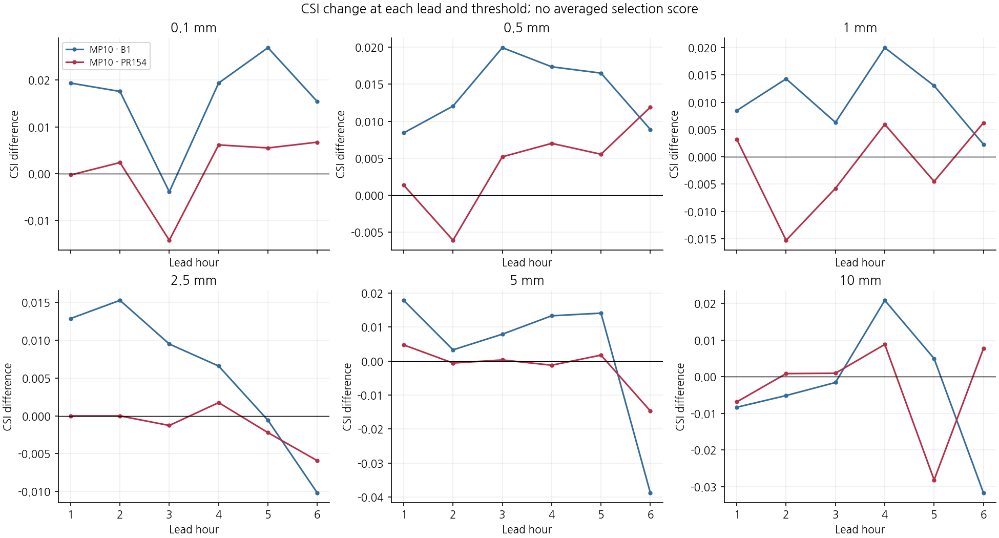

### 약한 강수 예측과 오경보

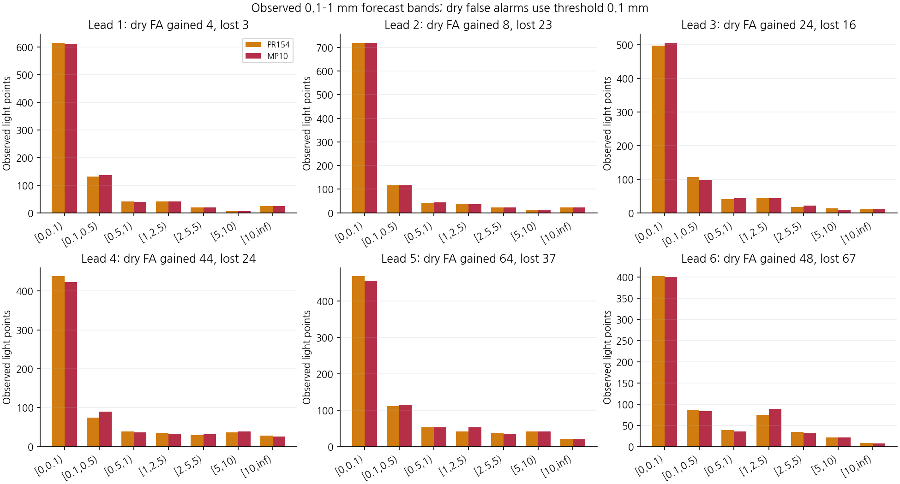

### 후보와 대조의 차이

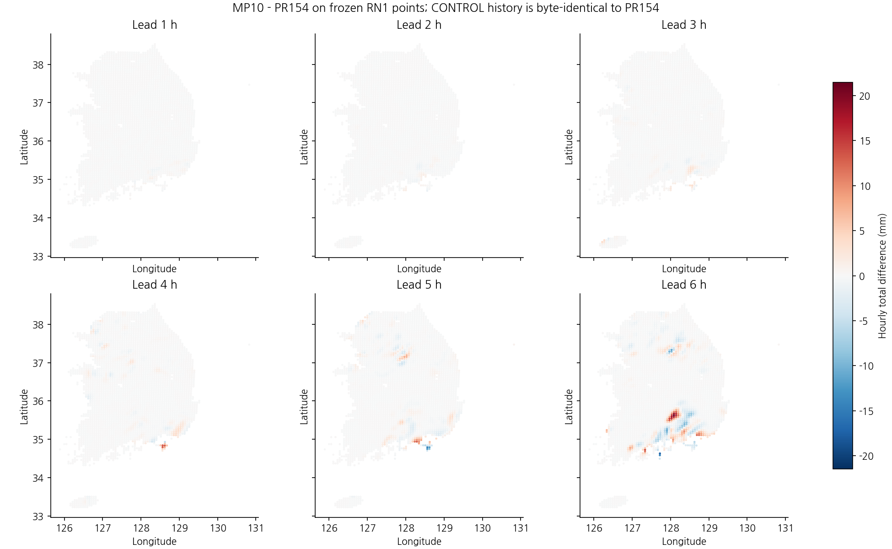

## 관측점의 시간별 강수

### 1시간 강수 지도

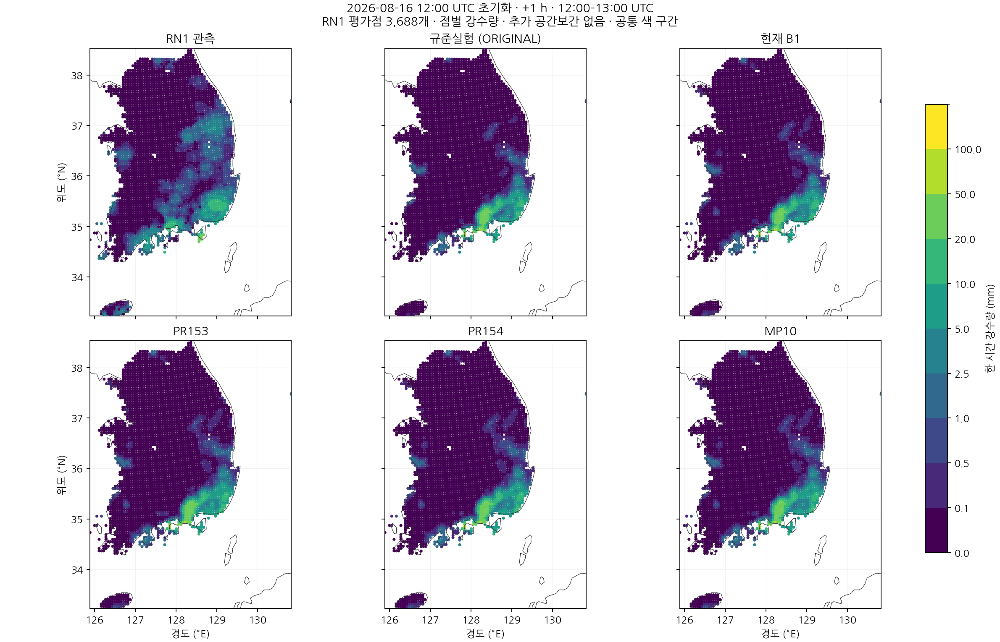

### 2시간 강수 지도

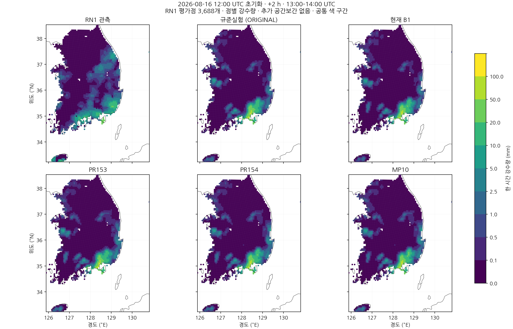

### 3시간 강수 지도

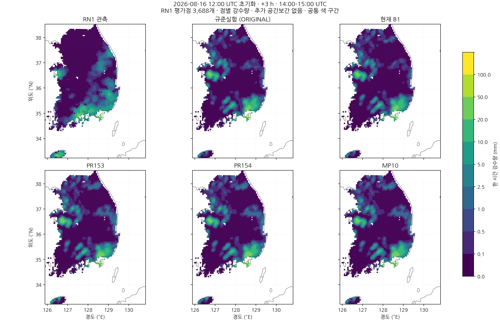

### 4시간 강수 지도

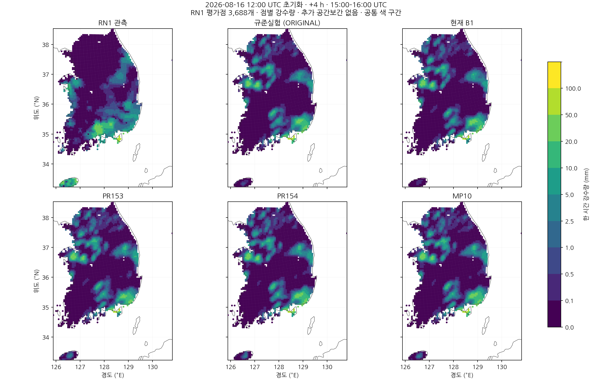

### 5시간 강수 지도

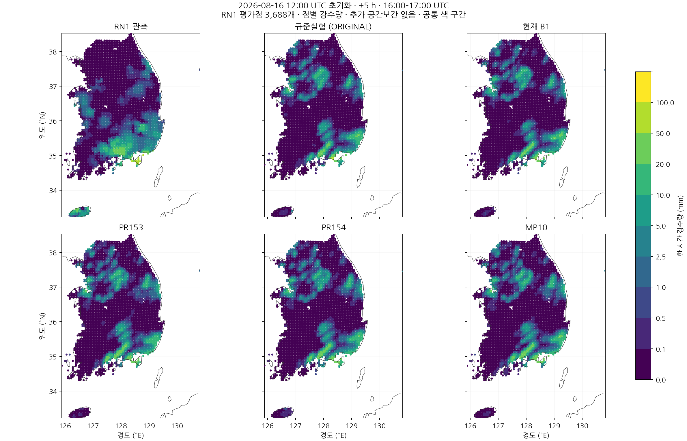

### 6시간 강수 지도

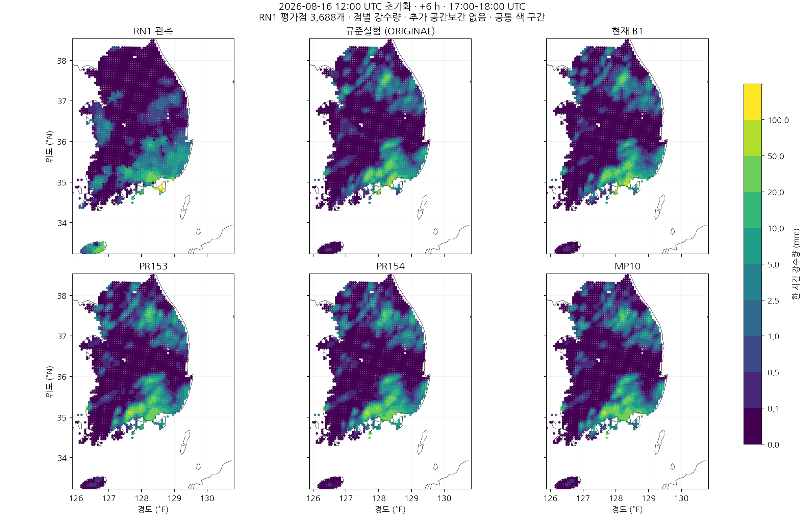
