# CP02 빗방울 수 과정 진단

선정 지점의 총 시간 강수량 진단이며 전체 표본의 성능 점수가 아닙니다. 서로 다른 지점과 시간을 평균하지 않았습니다. 총 강수량은 RAINC를 포함하며, KDM6 표면 강수 과정은 RAINNC에 해당합니다.

과정도는 비 입자수 후보에서 현재 B1을 뺀 값입니다. 낙하 변화는 포착된 비·눈·싸락눈 낙하 계산 범위이며, PREVP와 FINALCOND는 개별 호출의 수증기 성분입니다. RETURN 온도는 실제 래퍼 반환 상태의 차이입니다. 호출 사이 변화는 수송만을 뜻하지 않습니다. 연직축은 고도가 아닌 모형층 번호입니다. 변수별 색상 범위는 모든 선정 지점에서 같습니다.

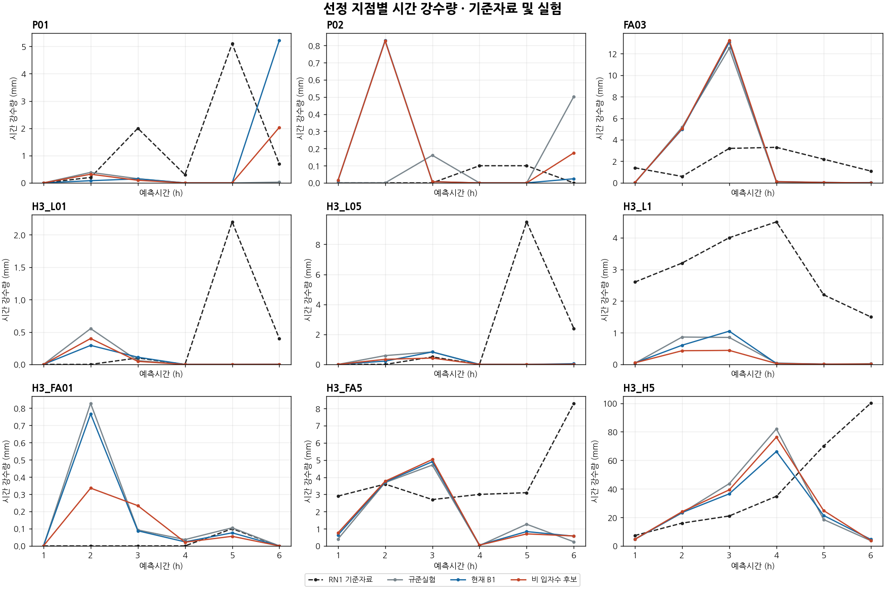

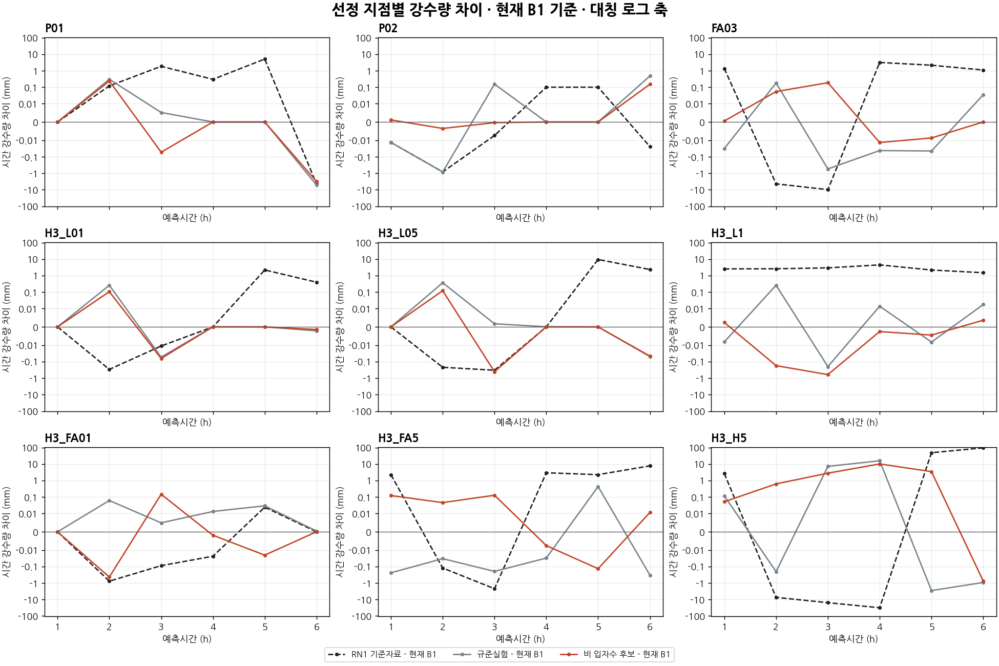

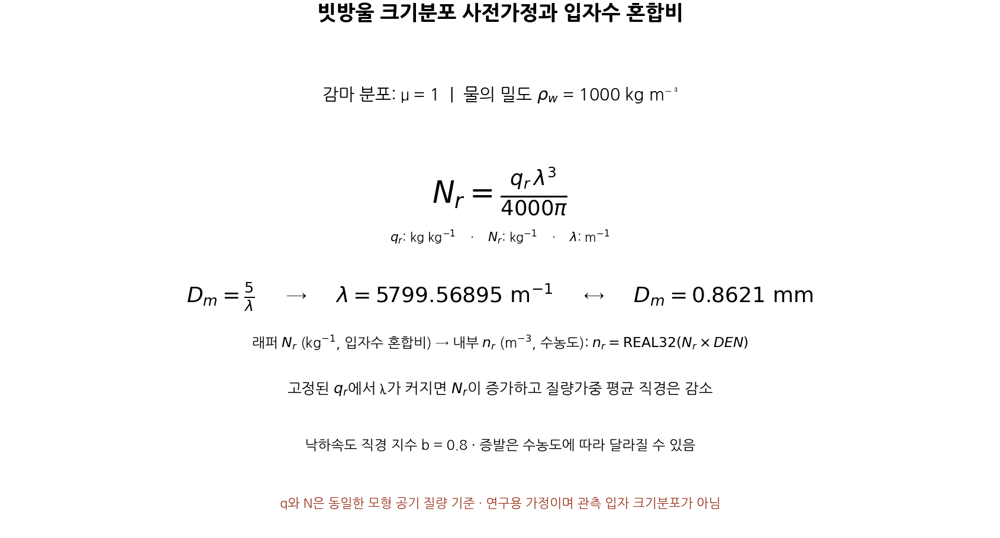

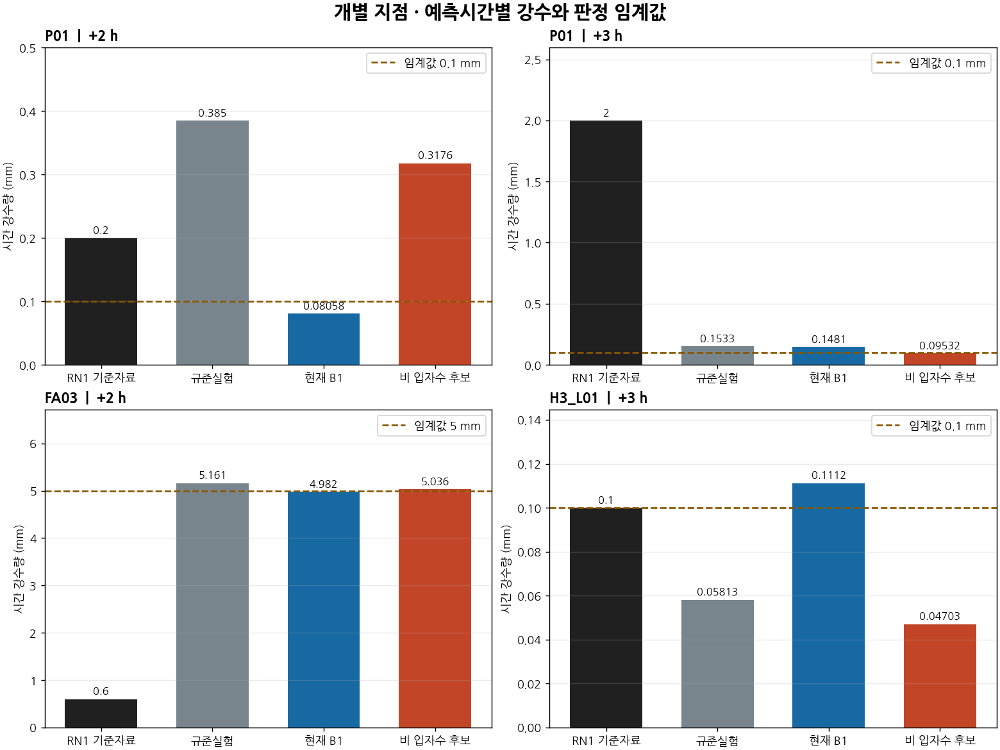

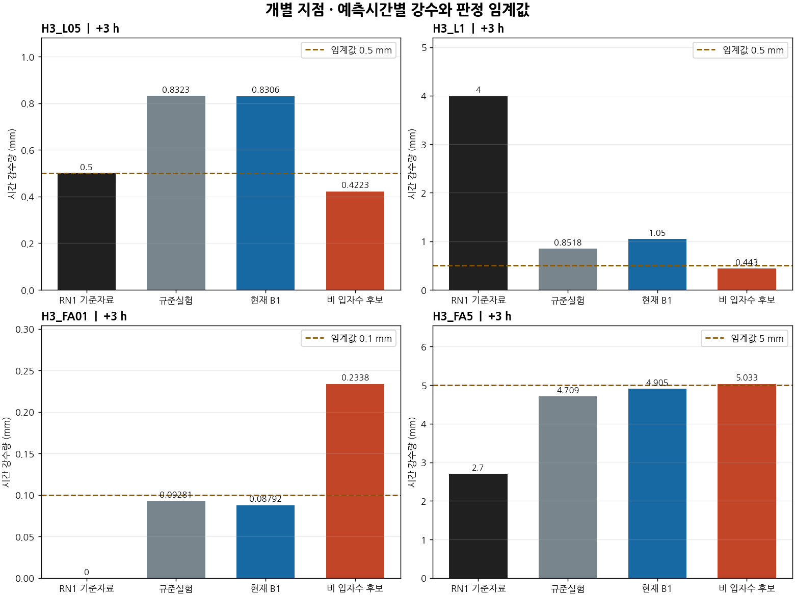

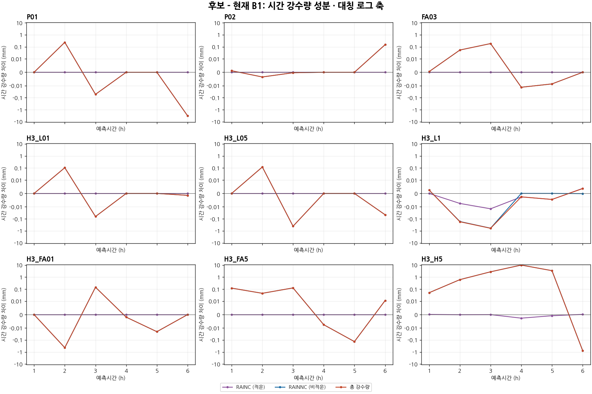

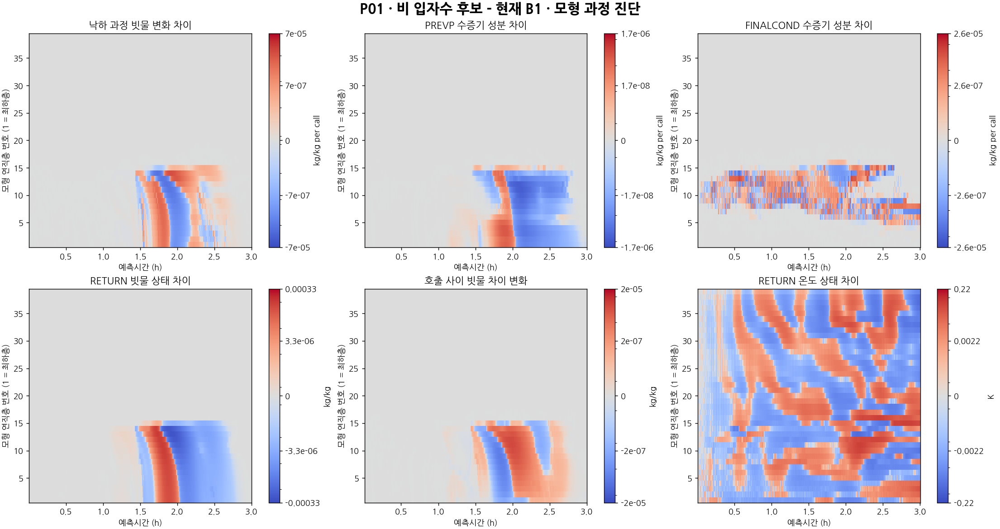

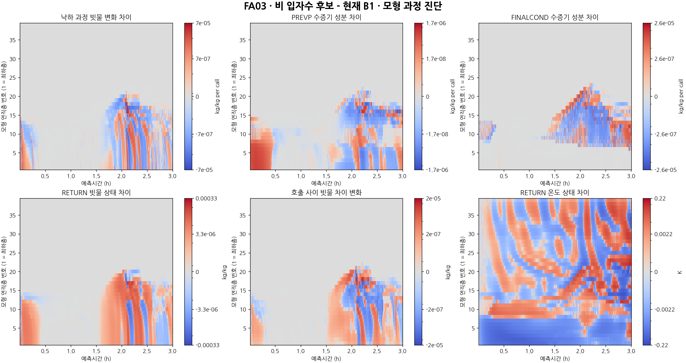

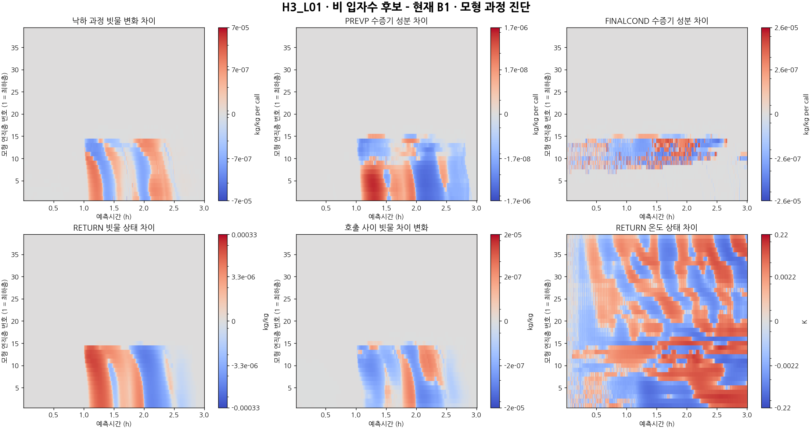

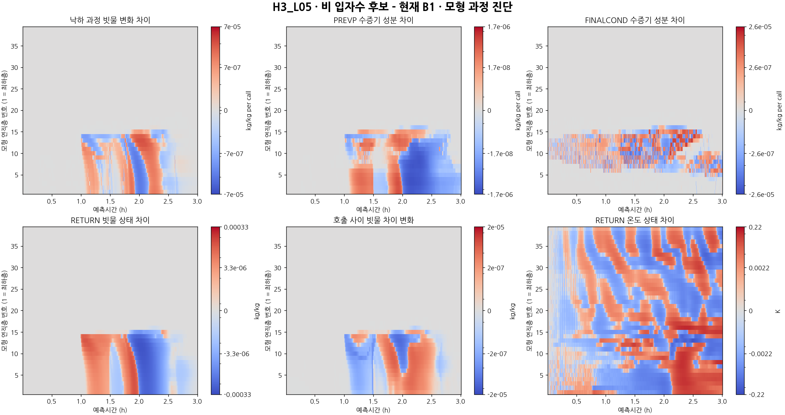

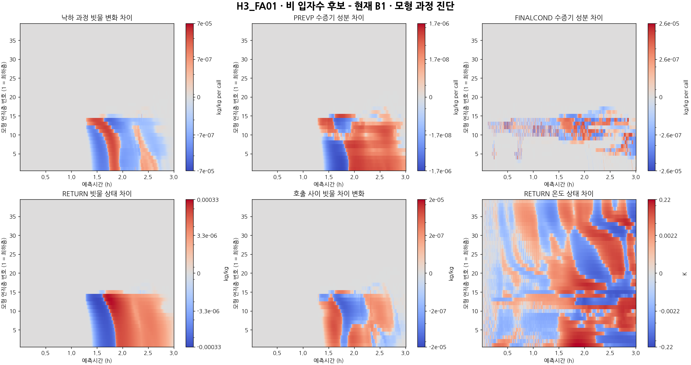
