# 보존 침강 후보: 전체 그림 모음

초기시각 2026-08-16 12 UTC. 규준실험은 ORIGINAL, 현재 B1은 FIX이며 보존 침강 후보는 미채택(19/26)입니다. 시간·임계값·실험을 평균하지 않습니다.

[학술 보고서](../../CP02_SEDIMENTATION_CONSERVATION_20261109.md) · [전체 H/M/F·CSI 표](evaluation/results/FULL_SCORES.md) · [그림·표 ZIP](all_figures.zip)

## P01 반환 비와 지상 강수의 시간 분포

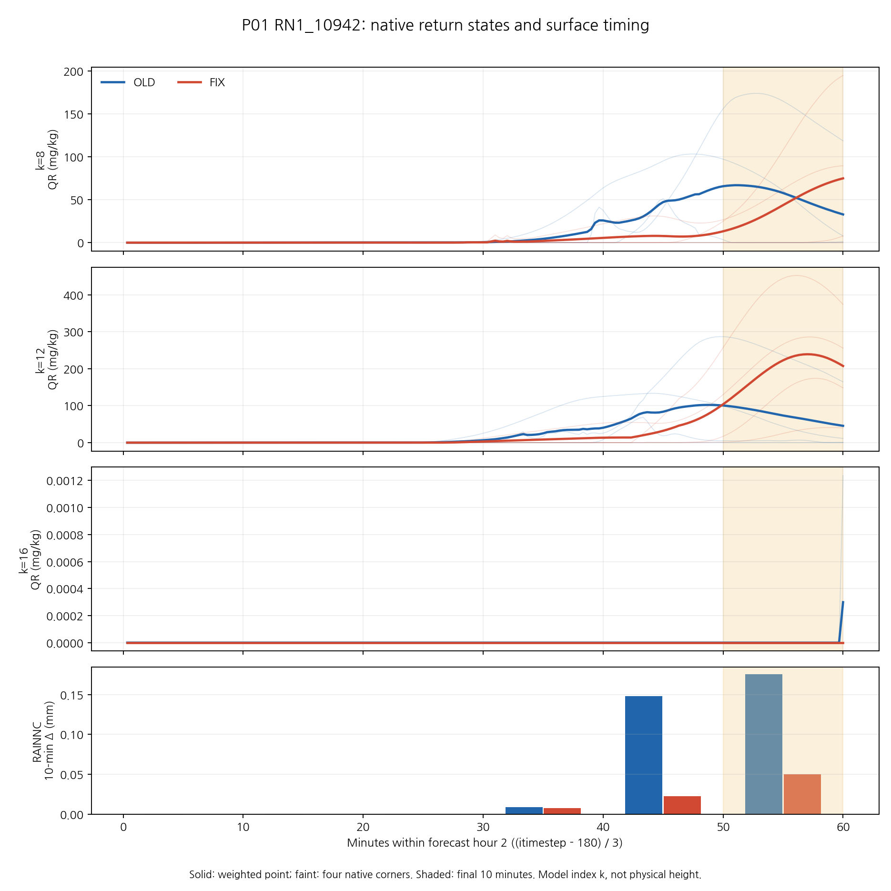

## 0.1 mm 이상 CSI: 모든 예측시간

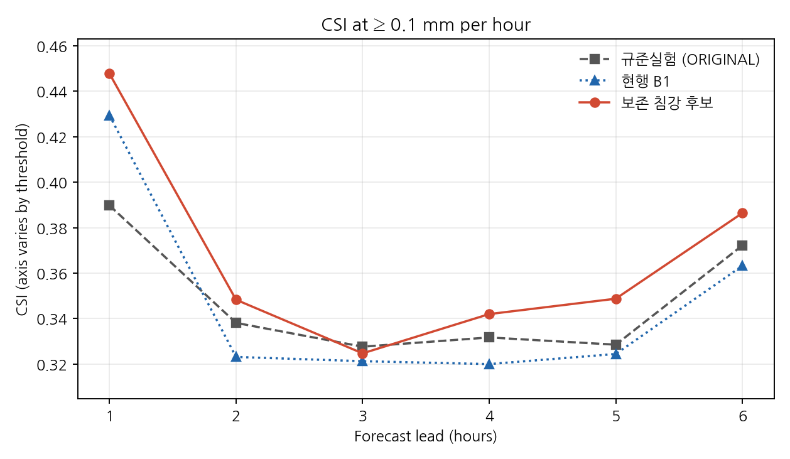

## 0.5 mm 이상 CSI: 모든 예측시간

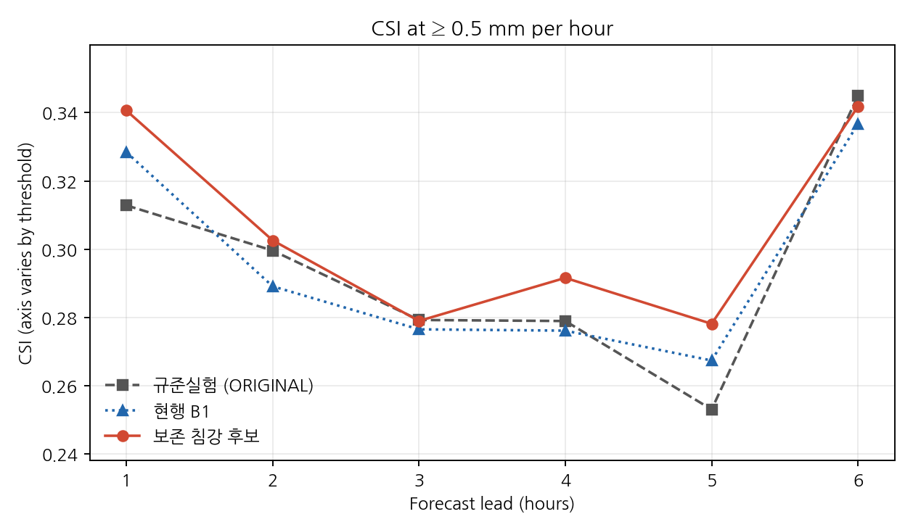

## 1 mm 이상 CSI: 모든 예측시간

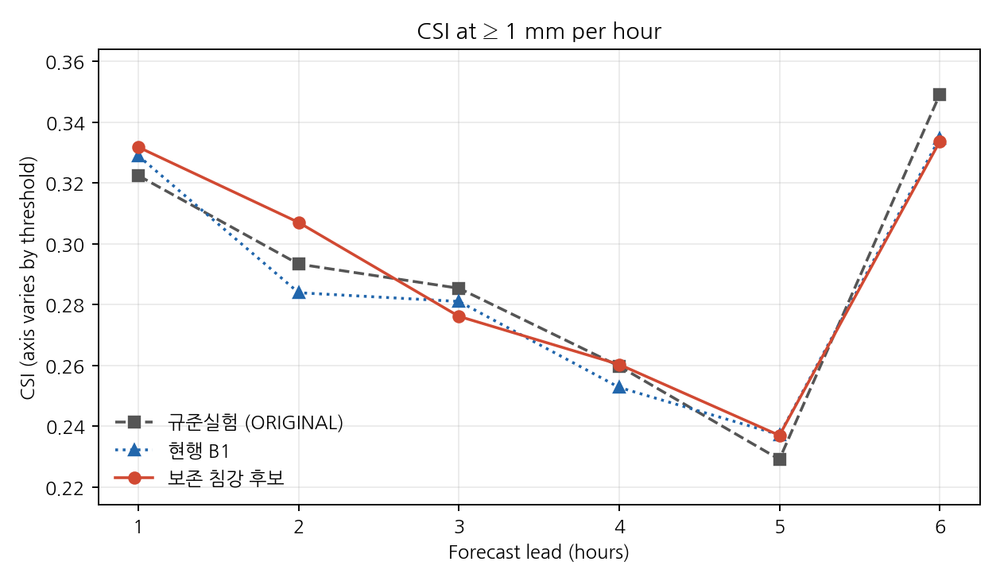

## 2.5 mm 이상 CSI: 모든 예측시간

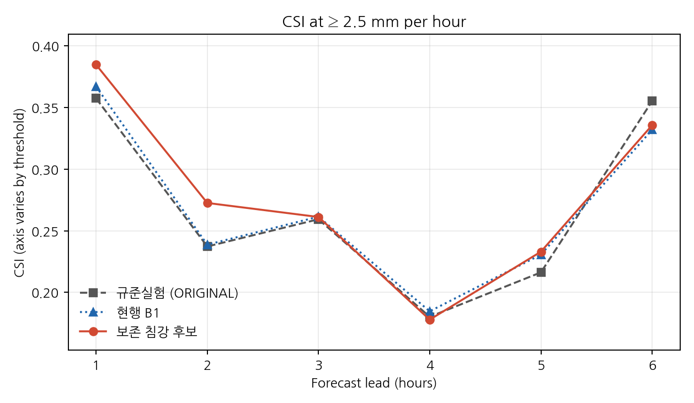

## 5 mm 이상 CSI: 모든 예측시간

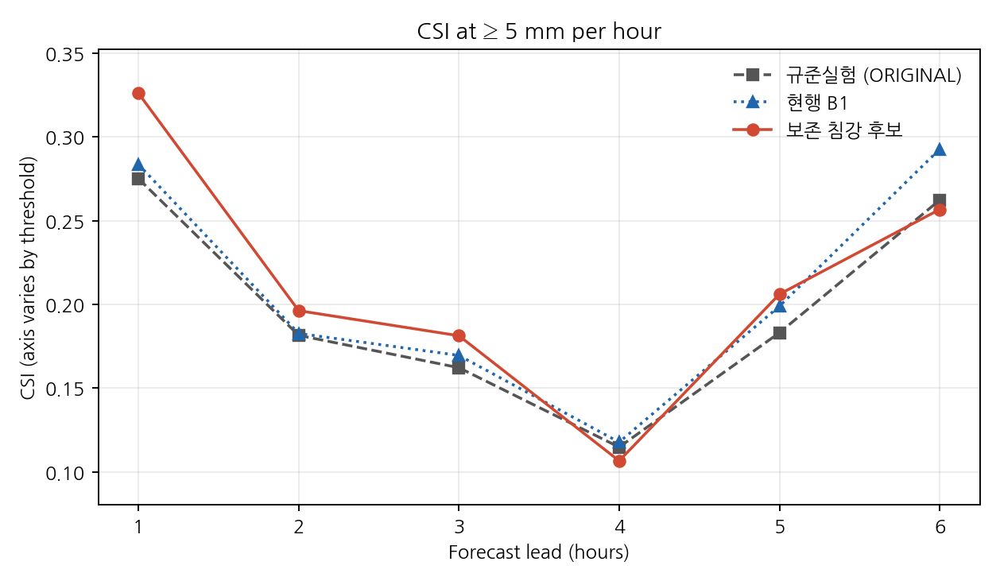

## 10 mm 이상 CSI: 모든 예측시간

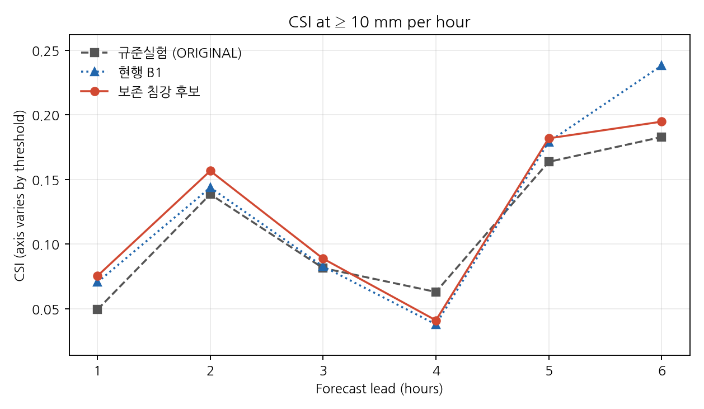

## +1시간: 12–13 UTC 한 시간 강수와 차이

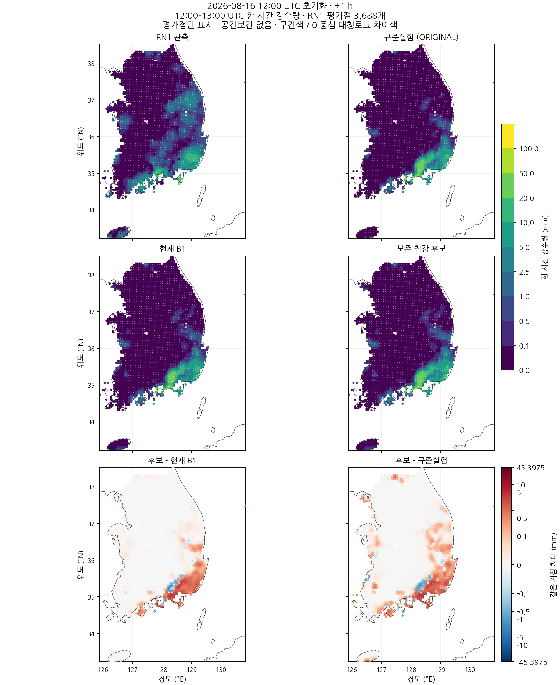

## +2시간: 13–14 UTC 한 시간 강수와 차이

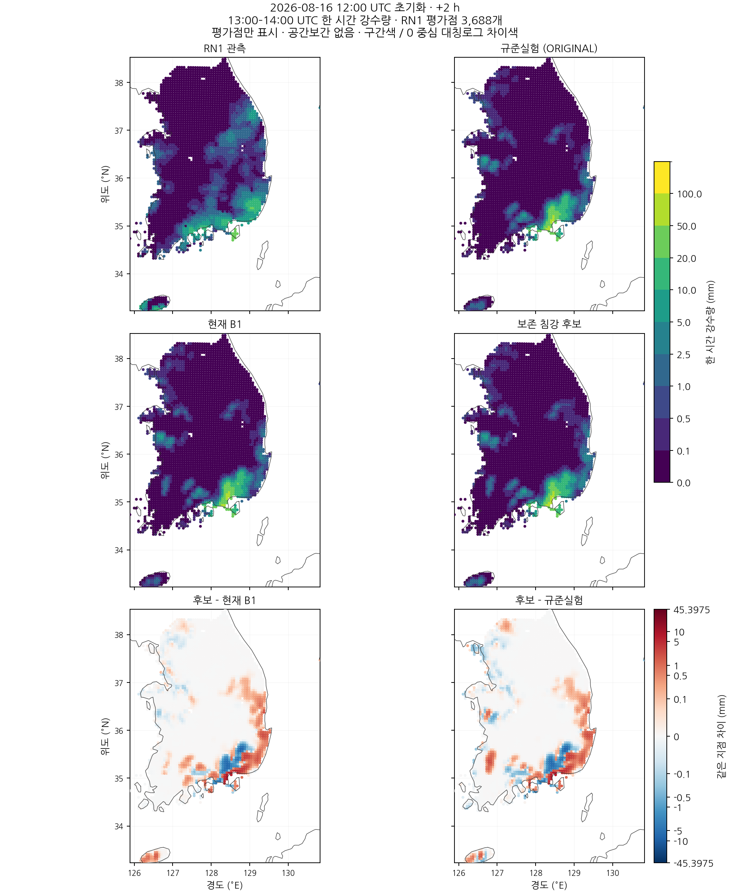

## +3시간: 14–15 UTC 한 시간 강수와 차이

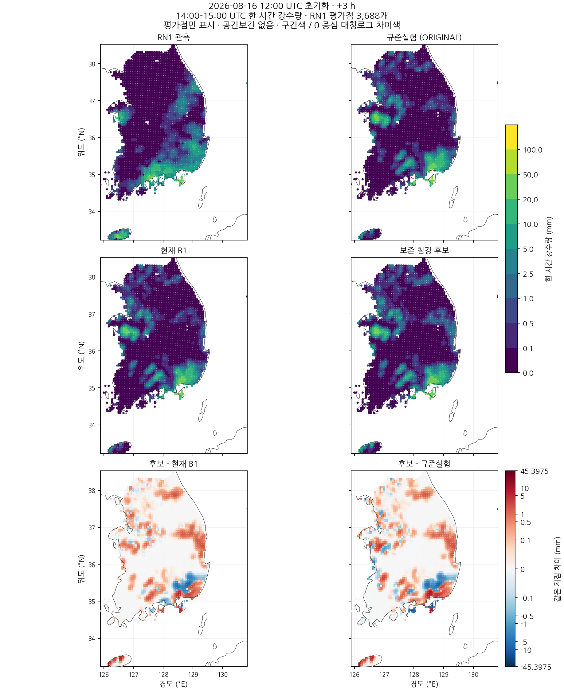

## +4시간: 15–16 UTC 한 시간 강수와 차이

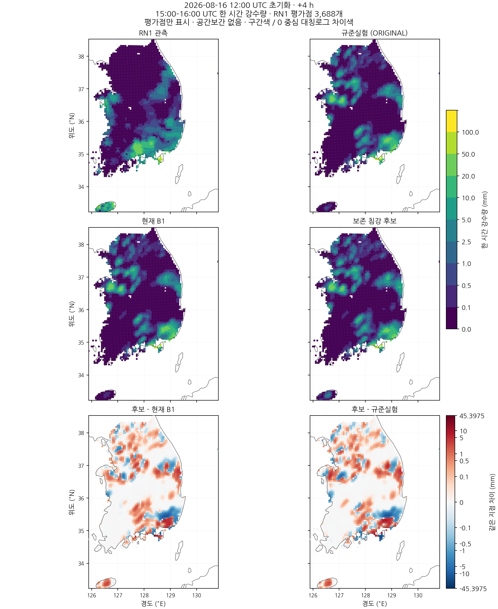

## +5시간: 16–17 UTC 한 시간 강수와 차이

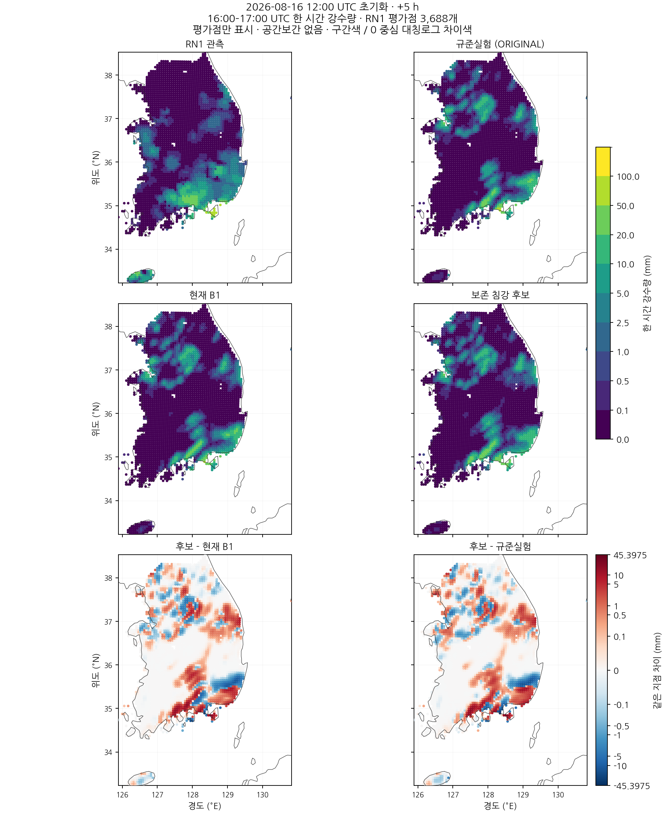

## +6시간: 17–18 UTC 한 시간 강수와 차이

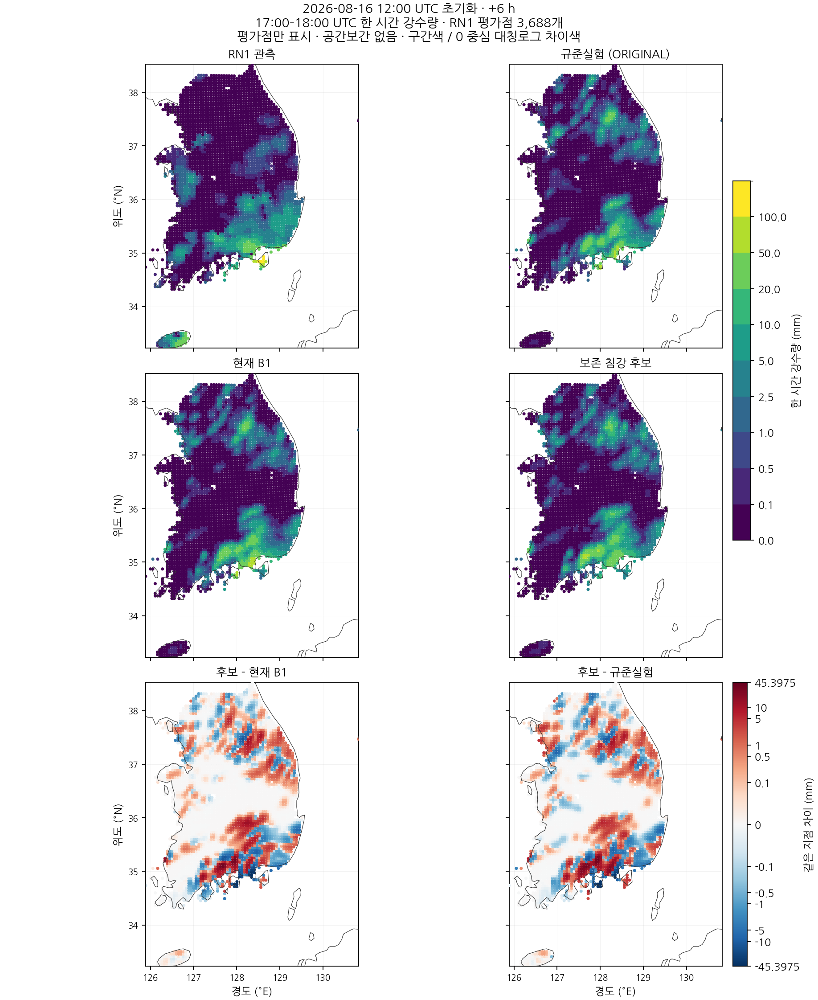

[이전 OLD/FIX 과정 그림](../cp02_protected_process_20261106/FIGURES.md)은 기존 경로에서 확인할 수 있습니다.
