# CP02 state-path and rain-number figures

Figures are embedded from this evidence folder for direct GitHub rendering. The candidate remains an unqualified research candidate; no averaging across leads or thresholds is applied.

## 기존 시간강수 요약

### false alarm transitions

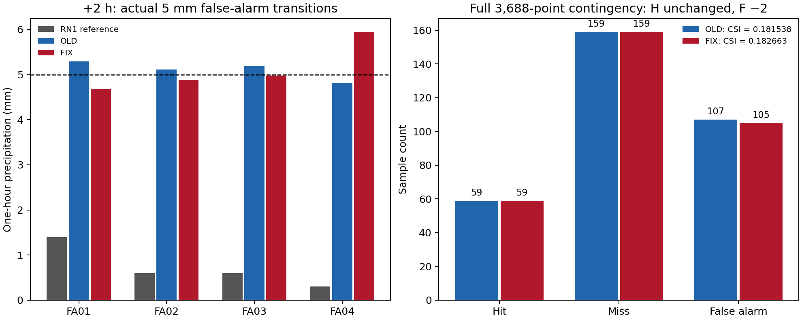

### p01 event amplitude

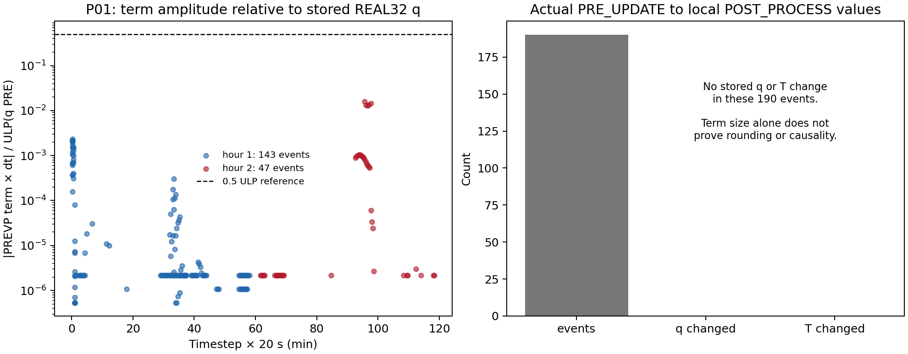

### paired csi

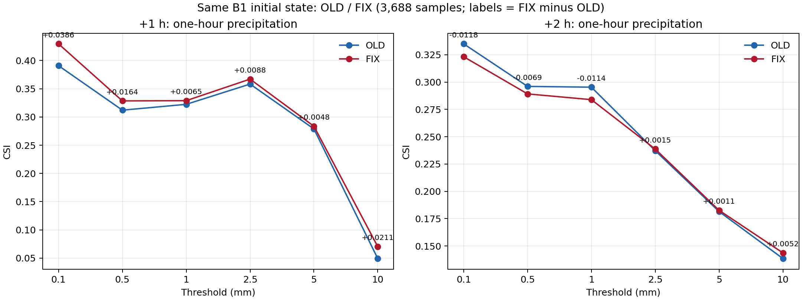

## Native state path

### native global numeric divergence

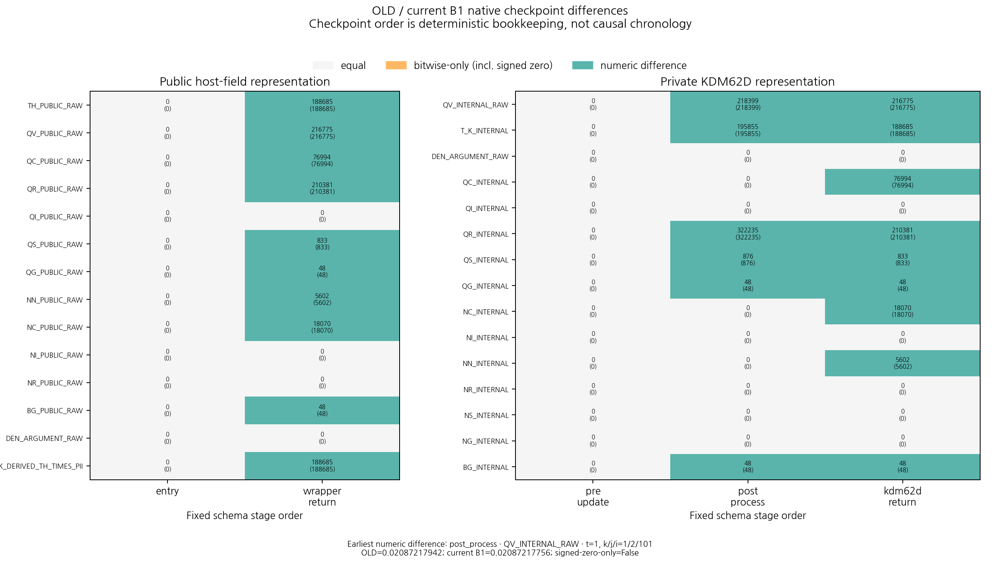

### native path qr public raw

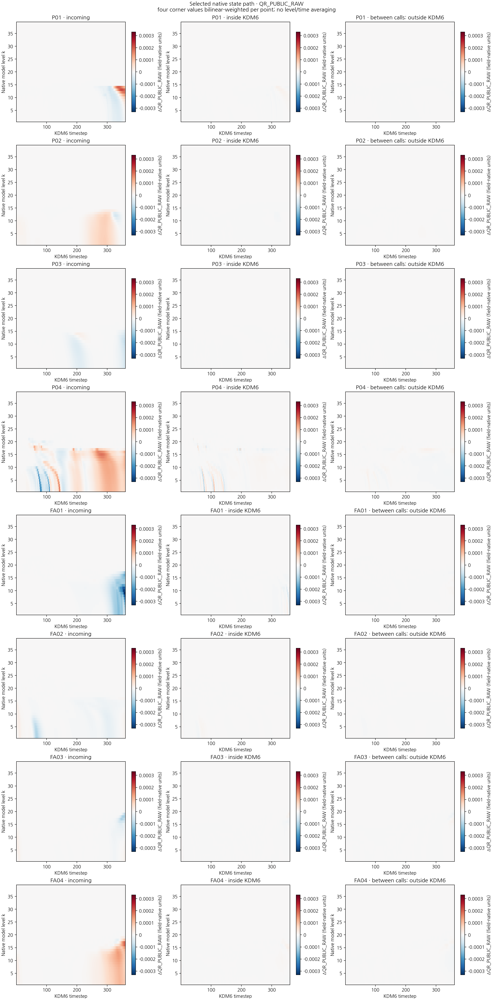

### native path qv public raw

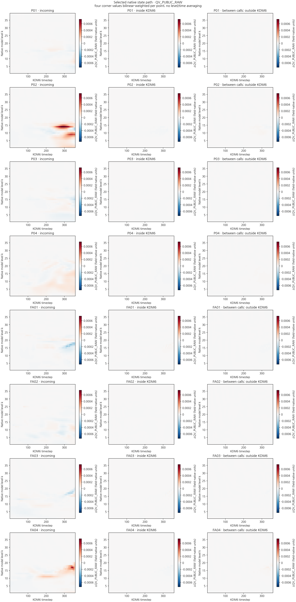

### native path qv public raw first20

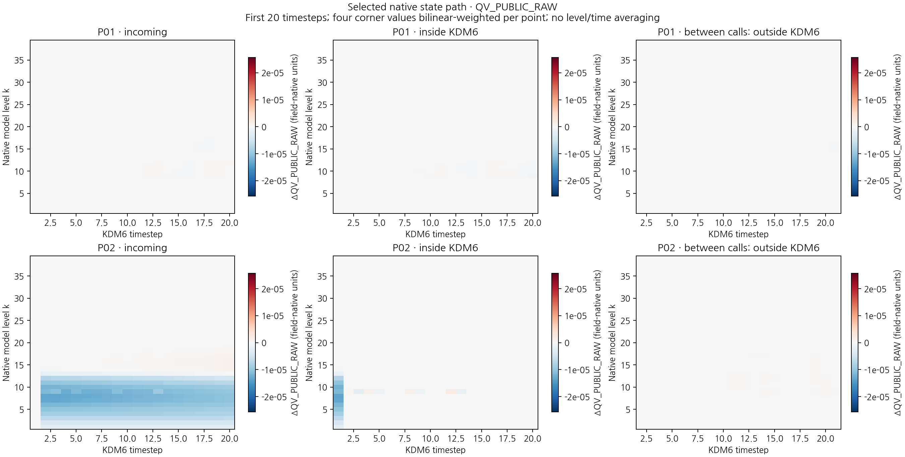

### native th vs actual temperature path

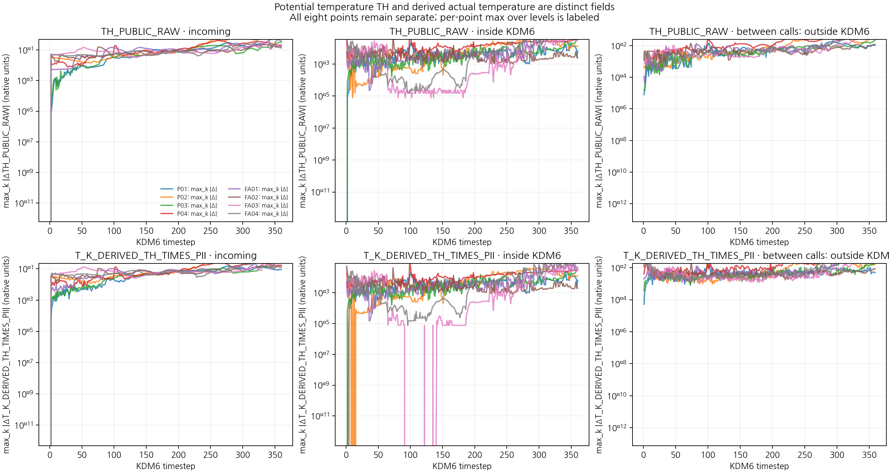

## Rain-number prior and evaluation

### rain number csi threshold 0.1mm

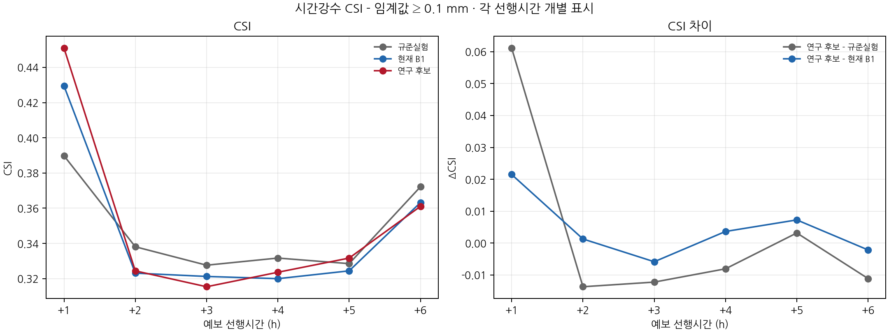

### rain number csi threshold 0.5mm

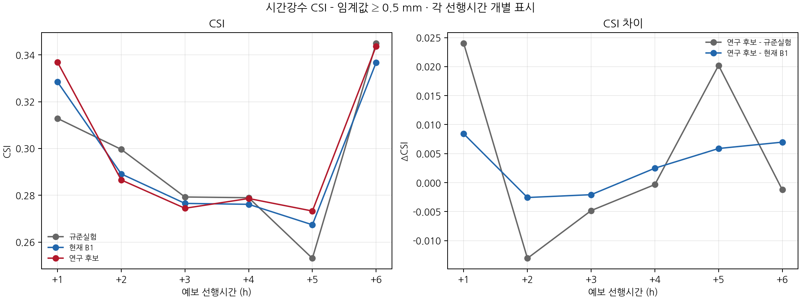

### rain number csi threshold 10mm

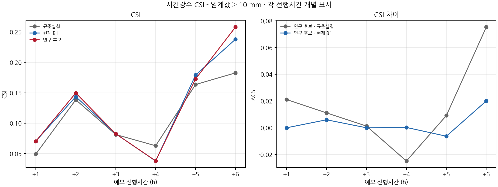

### rain number csi threshold 1mm

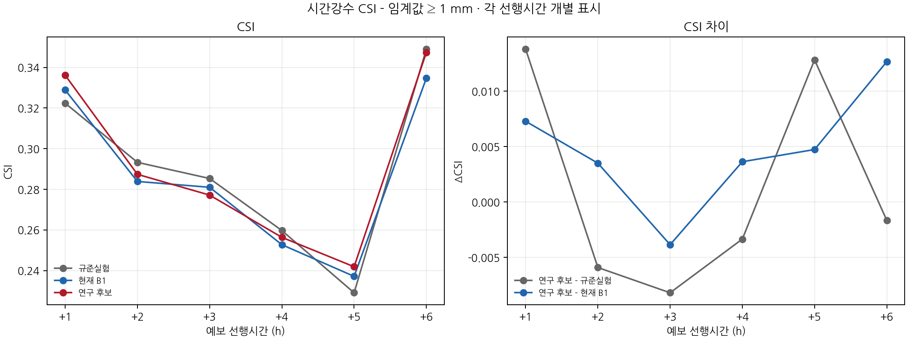

### rain number csi threshold 2.5mm

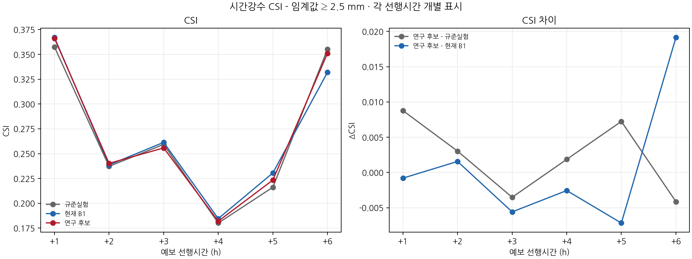

### rain number csi threshold 5mm

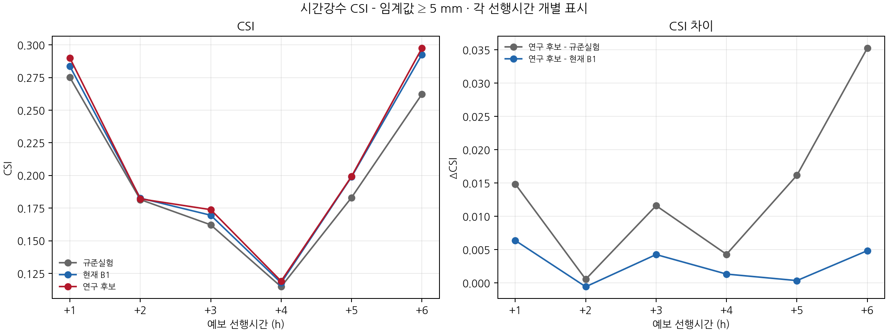

### rain number hour 13 maps

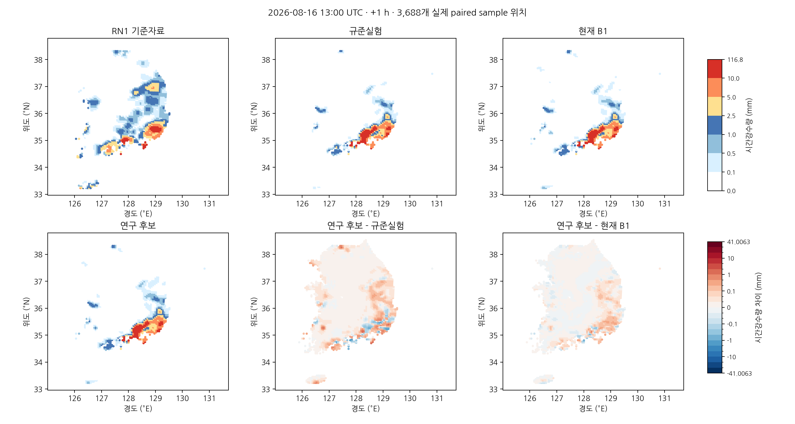

### rain number hour 14 maps

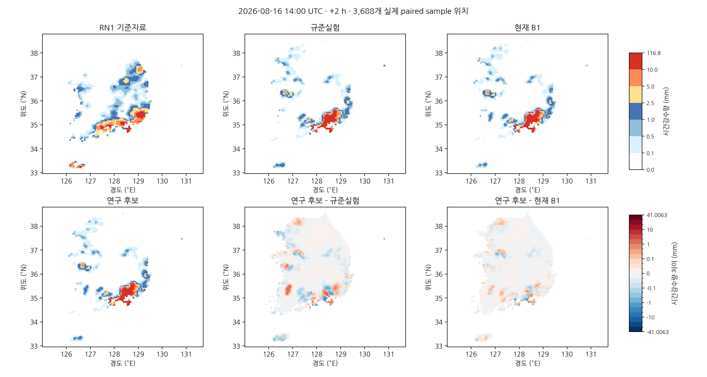

### rain number hour 15 maps

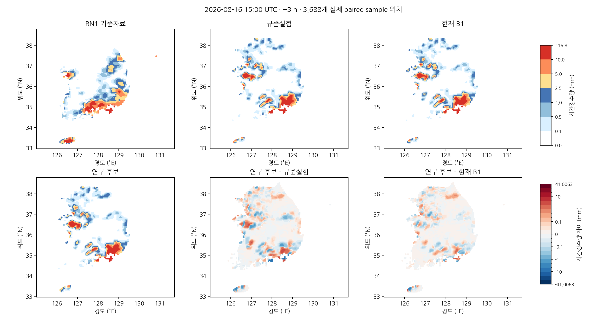

### rain number hour 16 maps

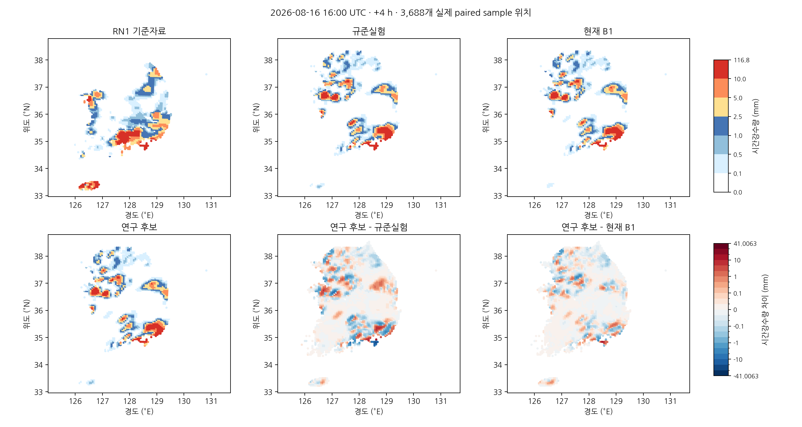

### rain number hour 17 maps

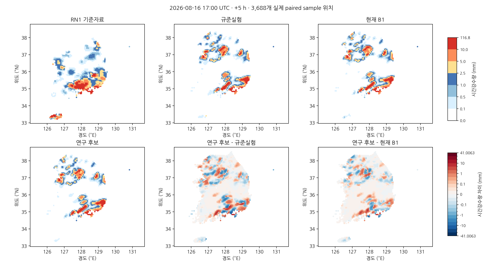

### rain number hour 18 maps

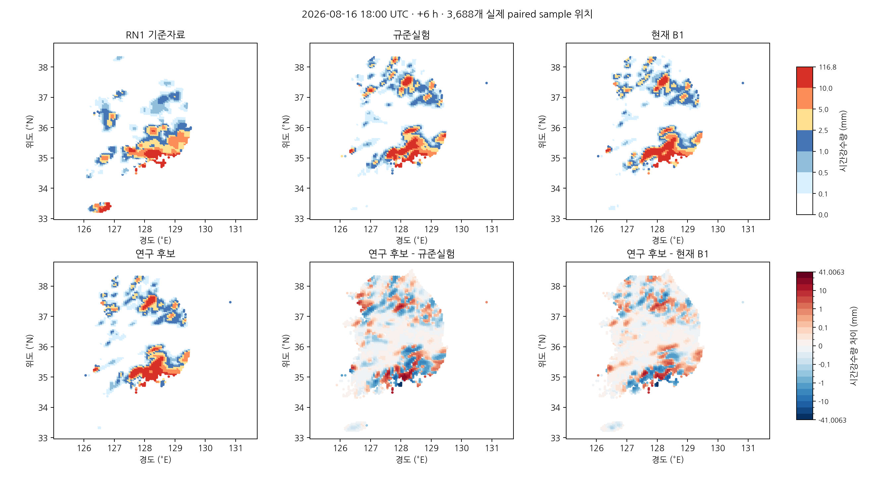

### rain number map scale bar

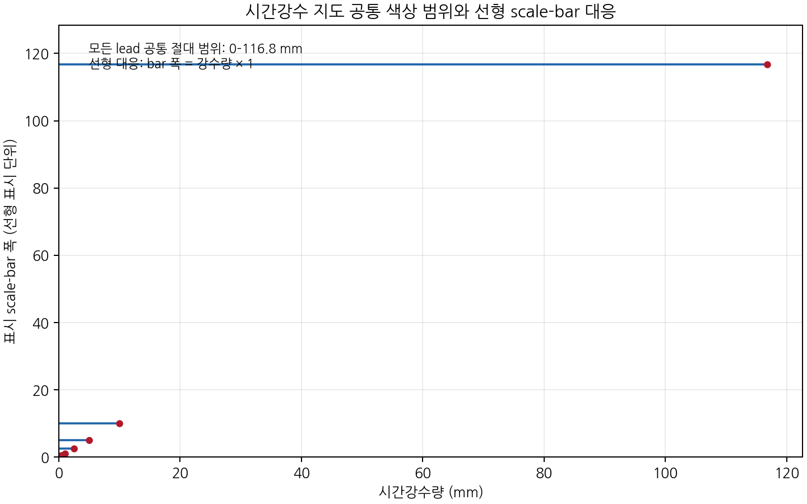

### rain number prior math

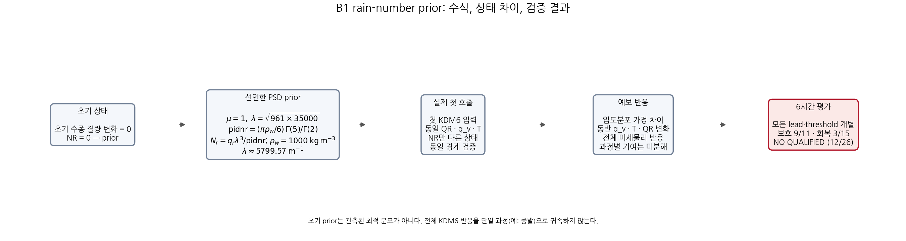
