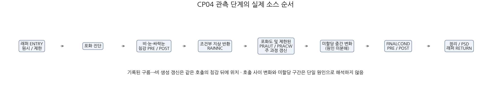
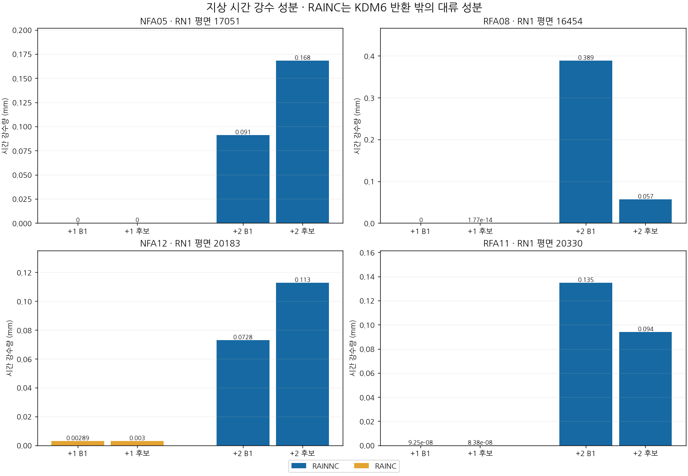
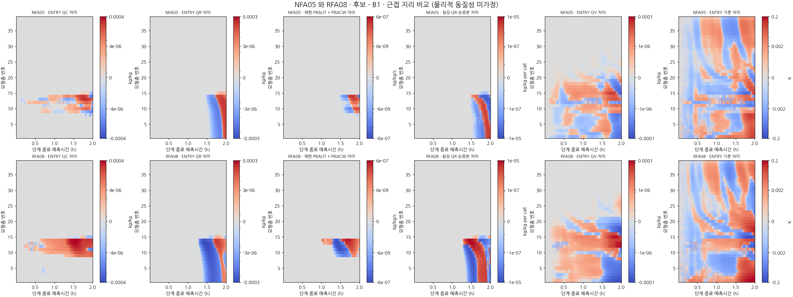
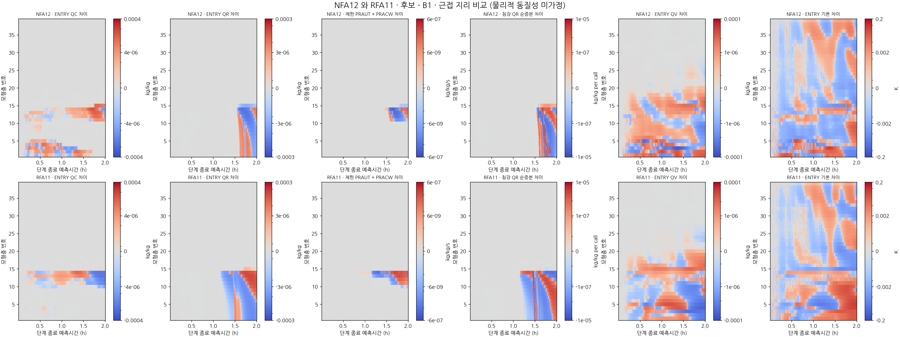
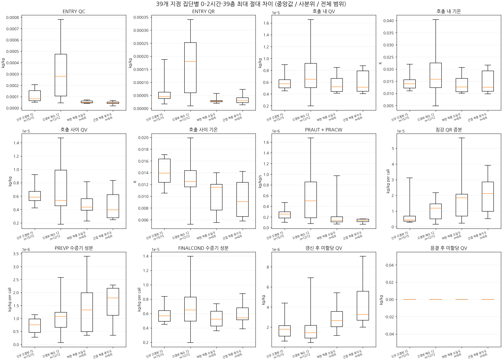
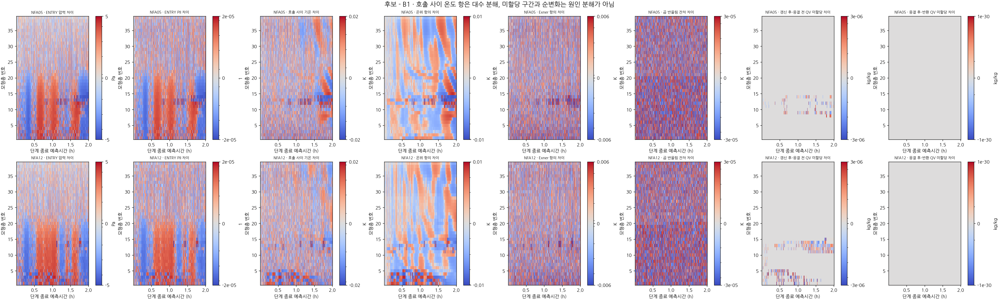
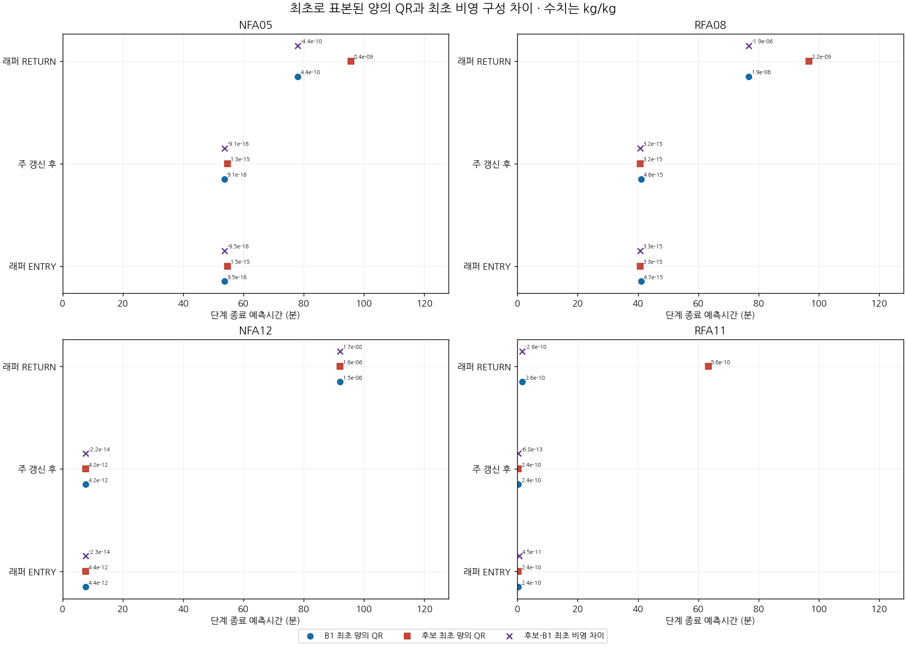

# 2시간 구름·비·열역학 경로

단계 표시는 단계 종료시각이며 ENTRY와 내부 단계는 그 단계 중 관측이다. 색상은 후보−B1; 각 물리량에서 비교 지점의 공통 대칭 척도다. PRAUT/PRACW는 같은 호출의 침강 이후에 기록된다. 조건부 미관측은 0이 아니며 호출 사이와 미할당 구간은 특정 물리 원인으로 귀속하지 않는다. 현재 B1과 후보의 고정 오일러 지점 비교이며 궤적이 아니다. [39지점별 진폭 표](group_amplitudes.csv)

NFA05(17051)↔RFA08(16454), NFA12(20183)↔RFA11(20330)는 각각 가장 가까운 해소 지점으로 약 21.1 km와 11.5 km 떨어져 있다. 지리적 비교이며 물리적 동질성을 가정하지 않는다. NFA12의 +1시간 총강수에는 별도 RAINC가 포함되고 +2시간 성분은 RAINNC다. 최초 양의 QR은 최초 구성 간 차이와 다르다. 빌리니어 평균에 원시 모서리의 qcrmin을 적용하지 않는다.

