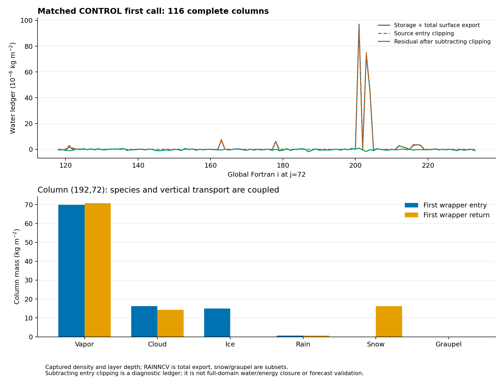
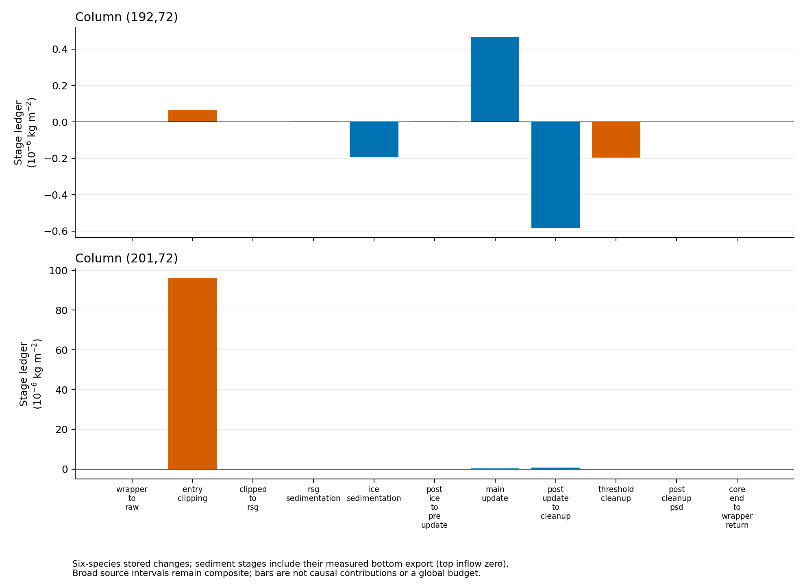

# 첫 호출 기둥 수지: 그림과 수치

[보고서](../../FIRST_CALL_WATER_BUDGET_20261112.md) · [ZIP](all_figures.zip)

[전체 기둥 CSV](analysis/column_ledger.csv) · [출처](figures/provenance.json)

[종별 단계 CSV](science/stage_telescope.csv) · [침강·clip·제거 장부](science/sediment_ledger.json)

116개 기둥은 한 행·한 첫 호출이며 독립 기상 사건 수가 아니다. RAINNCV는 총강수, 눈·싸락눈은 부분집합이다. 복합 구간은 한 과정의 인과 기여율이 아니고 전체 물·에너지 수지를 뜻하지 않는다. 큰 초기 QI 감소와 눈 증가를 함께 확인했지만 새 초기화·예보 성능 결과는 없다.

[같은 소스 재생](replay/README.md) · [검증 기록](validation/receipt.json) · [공간 정리](cleanup/receipt.json)
