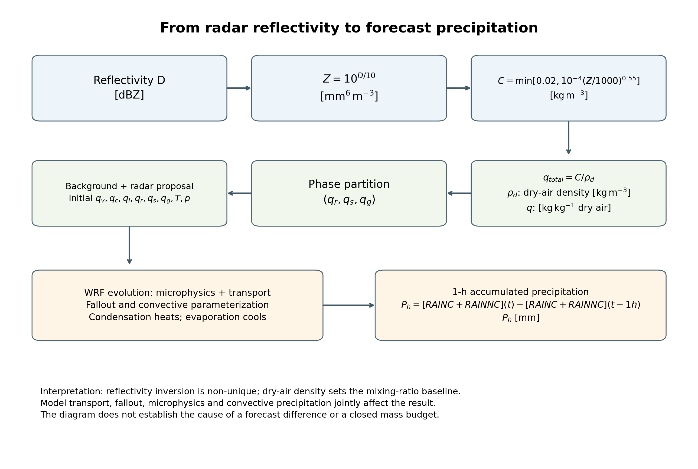
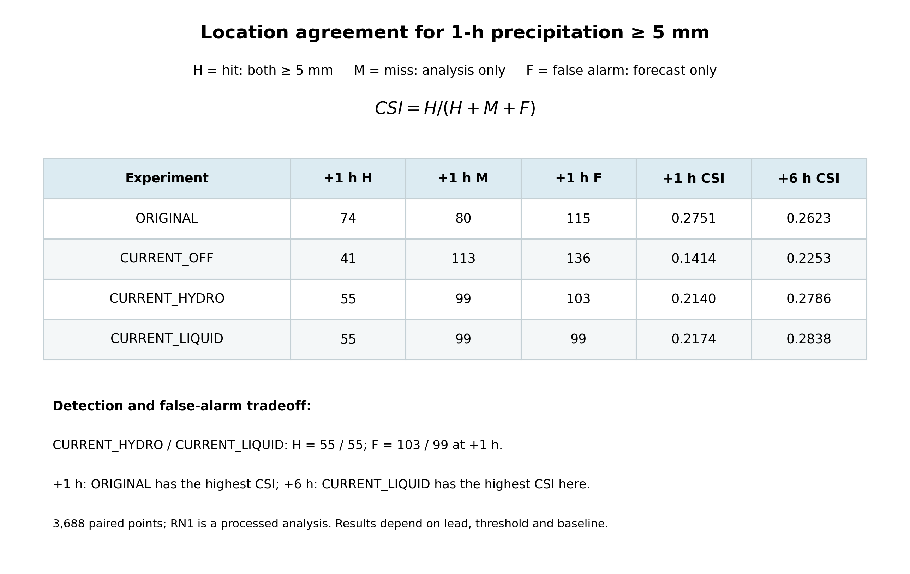
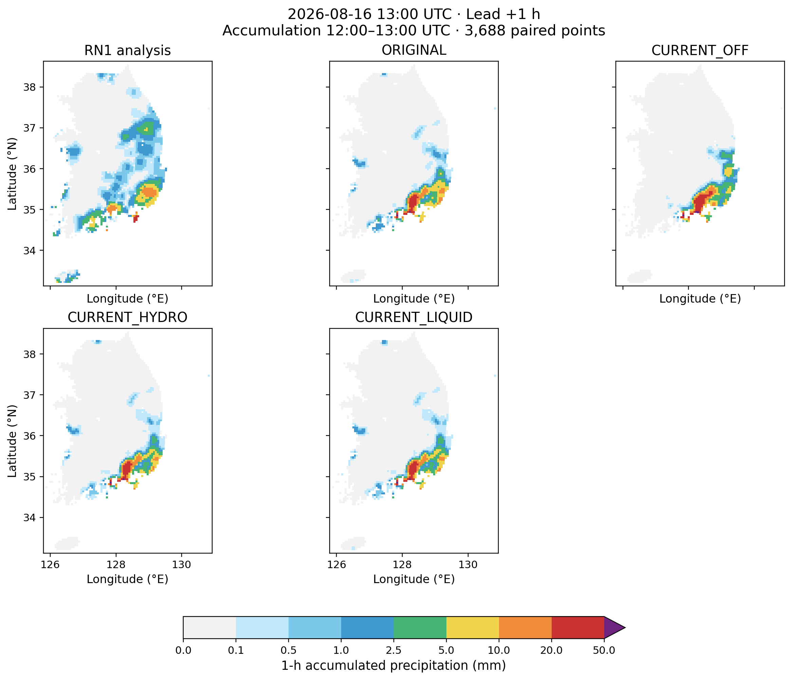
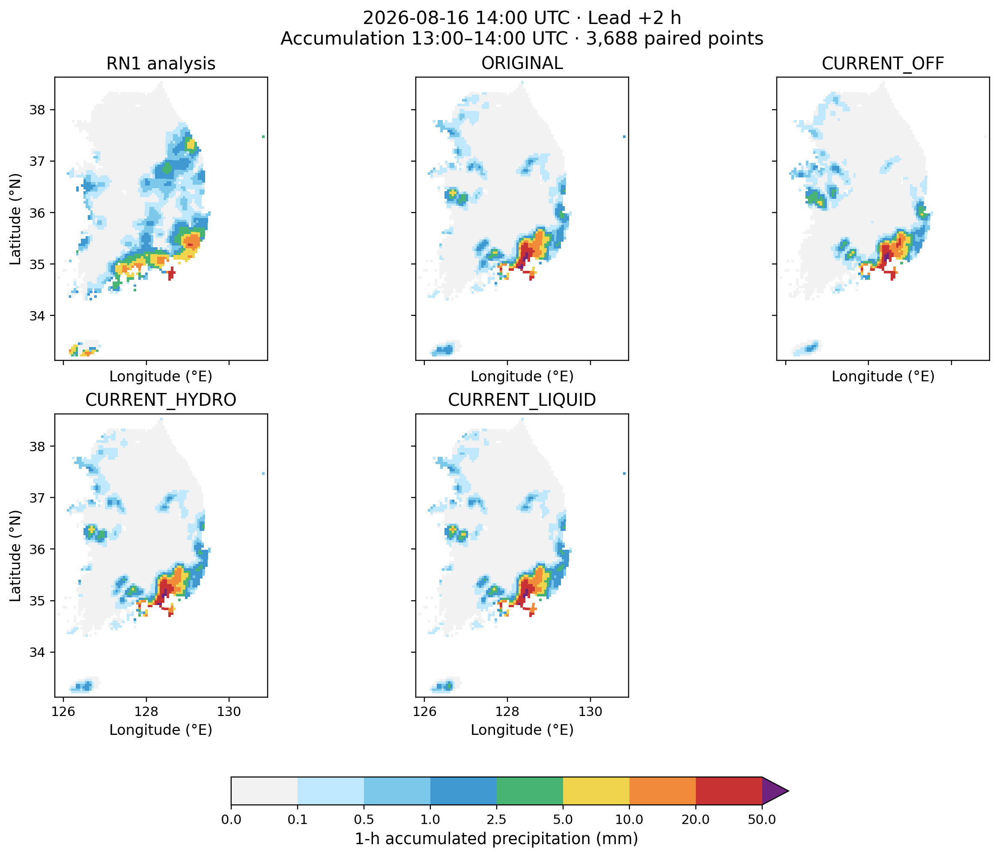
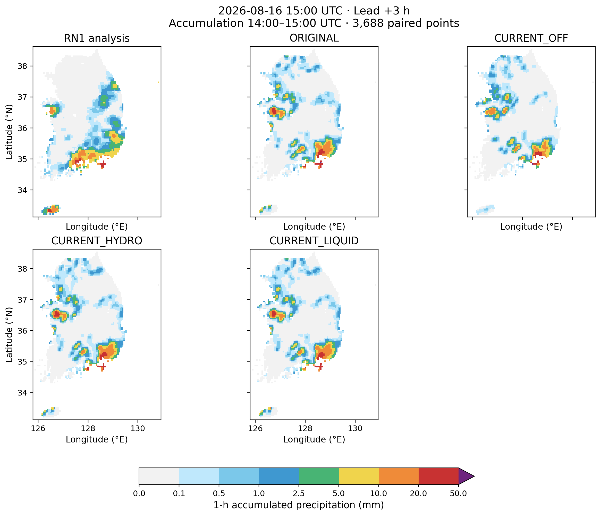
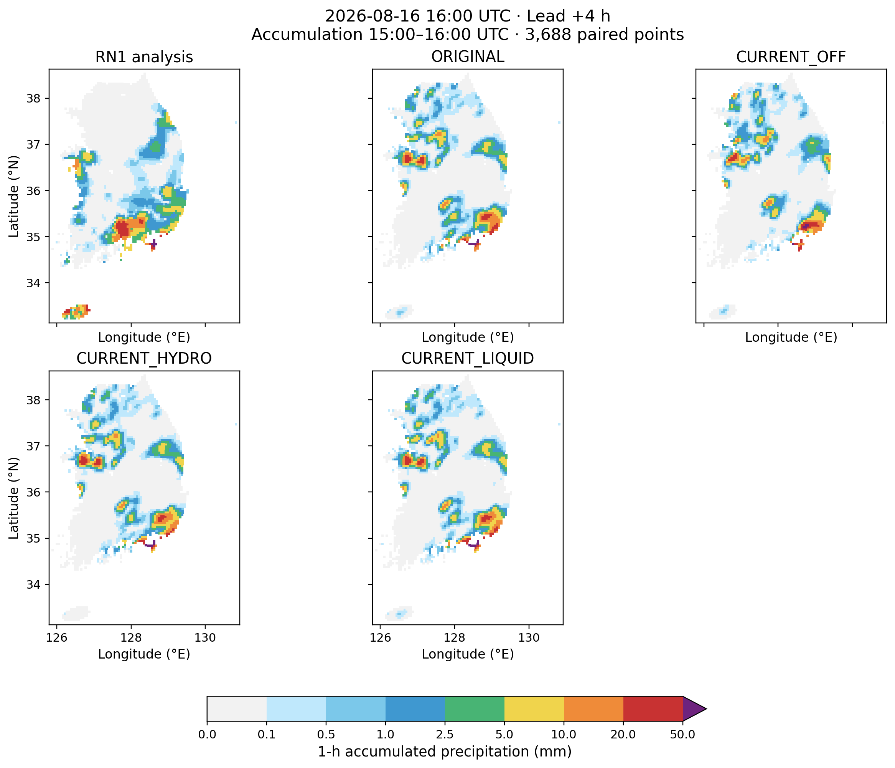
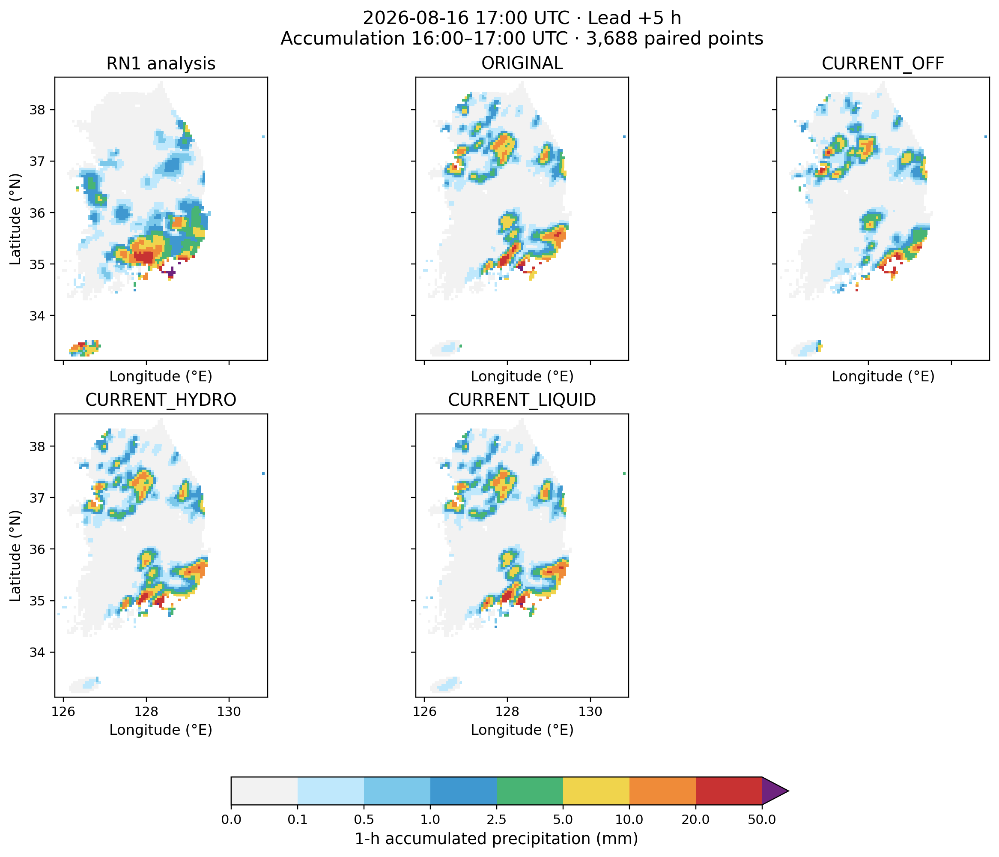
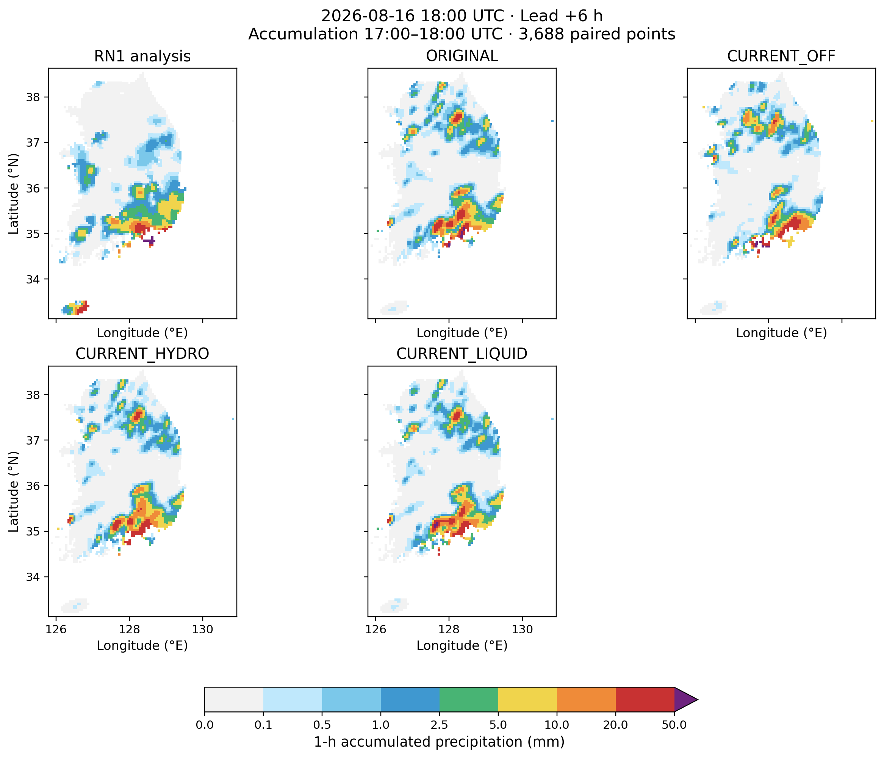

# 레이더 초기장과 시간별 강수 예측

**보고서 부록 · 근거 기준일 2026-10-30**

2026-08-16 12 UTC에 초기화한 단일 사례의 재예보에서 레이더 기반 초기장과 1시간 누적강수량의 관계를 살펴본다. 네 실험은 18 UTC까지 완료되었다. 기준일은 보고서 작성에 사용한 근거의 시점이며, 이 보고서를 위해 새 예보를 실행하지 않았다.

## 1. 레이더에서 예측 강수까지

레이더 반사도 D(dBZ)는 로그 척도다. 이를 선형 반사도 인자 `Z = 10^(D/10)`으로 바꾼다. 유효한 지상 위 레이더 셀에서 수송·publish·배경장 병합 전의 순간 작업 진단으로 총 강수성 수상체 농도 C와 건조공기 질량당 혼합비 q를 아래와 같이 계산한다.

`C = min[0.02, 10⁻⁴ (Z/1000)^0.55]`, `q = C / ρd = qr + qs + qg`

여기서 Z의 단위는 mm⁶ m⁻³, C와 건조공기 밀도 ρd의 단위는 kg m⁻³, 비·눈·싸락눈 혼합비 qr·qs·qg의 단위는 kg kg⁻¹이다. 이 관계는 현재 설정의 경험적 진단식이다. 레이더가 지상 강수량을 직접 측정하거나 수상체의 유일한 분포를 결정한다는 뜻은 아니다. 지수와 상한 때문에 반사도에 대한 수상체 반응도 비선형이다.

그림 1. 레이더 진단에서 수상체 초기장, 모델의 수송·물리, 1시간 누적강수량으로 이어지는 과정. 실제 모델 초기장은 순간 진단값과 동일하다고 가정하지 않는다.

초기 수상체의 위치와 양이 달라지면 이후 수송, 증발·응결, 상변화와 강수 발달이 함께 달라질 수 있다. 그러나 그림은 가능한 과정의 관계를 나타낸다. 이번 결과만으로 특정 과정이 지상 강수 변화의 원인이라고 증명하거나 전체 물·에너지 수지가 닫혔다고 주장할 수 없다. 격자 전체 물량은 건조공기 질량 md,i에 대해 `Mw = Σi md,i (qv + qc + qi + qr + qs + qg)i`로 정의할 수 있으며, 시간 변화에는 경계 수송과 지표 강수 등 플럭스가 필요하다. 국소 혼합비나 농도의 합만으로는 닫힌 수지가 아니다.

모델의 시간별 강수량은 각 예측시각에서 누적 강수 `RAINC + RAINNC`의 인접 시각 차이다. 예를 들어 +1h는 12–13 UTC의 **1시간 누적강수량(mm)**이며, +6h는 17–18 UTC의 값이다. 두 값은 각각 1시간 구간을 나타낸다.

## 2. 비교와 해석

**RN1 분석장**은 레이더·AWS와 추가 처리로 만든 강수 참조장이다. **ORIGINAL**은 보관된 실제 OFF 초기장, **CURRENT_OFF**는 현행 소스로 만든 OFF 초기장, **CURRENT_HYDRO**와 **CURRENT_LIQUID**는 현행 소스로 만든 후보 초기장이다. 네 적분에는 같은 보관 WRF 실행파일을 사용했다. ORIGINAL과 CURRENT_OFF는 초기장 준비 경로가 다르므로 이 둘의 차이에는 전처리 변화가 섞여 있다. CURRENT 후보와 CURRENT_OFF의 비교도 모드별 초기장 작성 차이를 포함한다.

1시간 누적강수량이 5 mm 이상인 사건에 대해 H는 적중, M은 미탐지, F는 오경보다. `CSI = H / (H + M + F)`는 이 세 사건을 함께 고려하는 점수다. CSI가 높아져도 어떤 적중이 추가되거나 사라졌는지, 오경보가 어떻게 달라졌는지 함께 살펴야 한다.

그림 2. 5 mm 이상 사건의 H·M·F와 CSI, 그리고 +1h와 +6h에서 기준군에 따라 달라지는 비교. 점수는 동일한 3,688개 지리 평가점의 RN1 분석장과 비교한 값이다.

+1h의 CSI는 ORIGINAL 0.2751, CURRENT_OFF 0.1414, CURRENT_HYDRO 0.2140, CURRENT_LIQUID 0.2174다. 두 후보는 CURRENT_OFF보다 높지만 ORIGINAL보다 낮다. +6h에는 각각 0.2623, 0.2253, 0.2786, 0.2838이다. 시간과 기준에 따라 결과가 달라지므로 한 사례로 일반적인 성능 향상을 결론 내릴 수 없다. RN1의 관측 가능 범위와 상류 입력의 시간별 최신성도 아직 확인해야 한다. [시간별 점수와 진행 현황 부록](../../../HOURLY_PRECIPITATION_PROGRESS_APPENDIX_20261030.md)

## 3. 시간별 강수 지도

다음 그림은 같은 유효구간의 RN1 분석장과 네 예측을 같은 색 구간으로 나타낸다. 점은 평가 격자점 값이며 실제 관측 footprint가 아니다. RN1과 모델 격자의 공간 대표 범위 차이를 고려해 해석한다.

그림 3. 예측시간 +1h, 유효구간 2026-08-16 12–13 UTC의 1시간 누적강수량(mm).

그림 4. 예측시간 +2h, 유효구간 2026-08-16 13–14 UTC의 1시간 누적강수량(mm).

그림 5. 예측시간 +3h, 유효구간 2026-08-16 14–15 UTC의 1시간 누적강수량(mm).

그림 6. 예측시간 +4h, 유효구간 2026-08-16 15–16 UTC의 1시간 누적강수량(mm).

그림 7. 예측시간 +5h, 유효구간 2026-08-16 16–17 UTC의 1시간 누적강수량(mm).

그림 8. 예측시간 +6h, 유효구간 2026-08-16 17–18 UTC의 1시간 누적강수량(mm).
