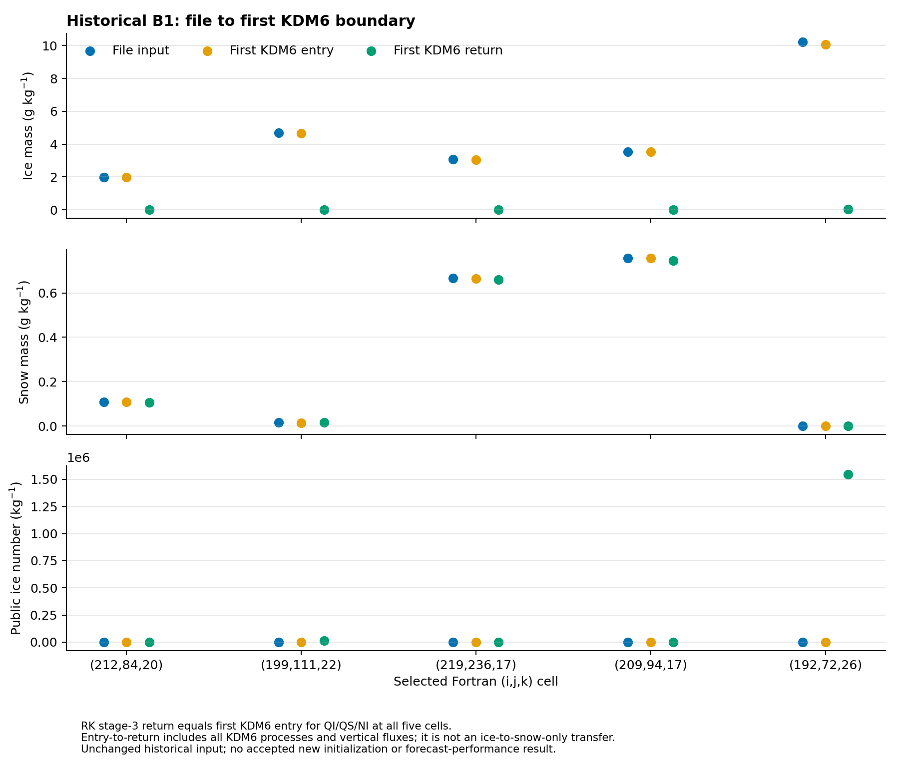

# QI·QS·NI 결합과 전달 경계 자료

[보고서](../../ICE_SNOW_JOINT_INITIALIZATION_20261111.md) · [그림·자료 ZIP](all_figures.zip)

파일·첫 KDM6 진입·반환을 같은 다섯 셀에서 비교한다. 세 번째 RK 반환은 첫 KDM6 진입과 QI·QS·NI 15개 REAL32 단어가 일치한다. 반환까지의 차이는 전체 미세물리와 수직 유출 등을 포함하며 빙정→눈 변환량이 아니다. NI는 공개 kg^-1 값이다.

- [수치 CSV](figures/native_handoff.csv)
- [그림 출처](figures/provenance.json)
- [원시 기록의 실행 범위](native/README.md)
- [실제 실행 검증](native/receipt.json)
- [코드 검증](validation/receipt.json)

새로 초기화한 입력을 실제 WRF에 전달하거나 6시간 예보를 평가한 결과는 아니다. PNG·보고서·주요 수치를 ZIP에 포함하며 PDF는 만들지 않는다.
