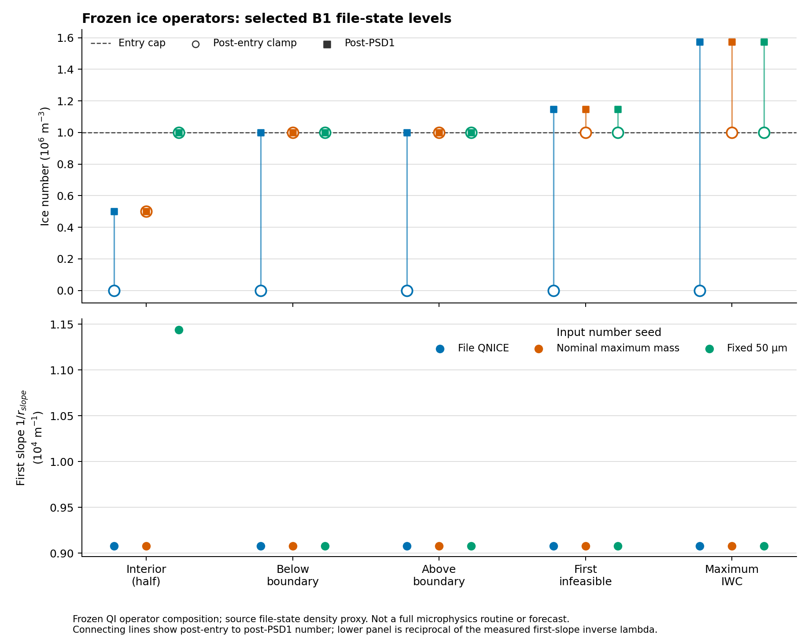
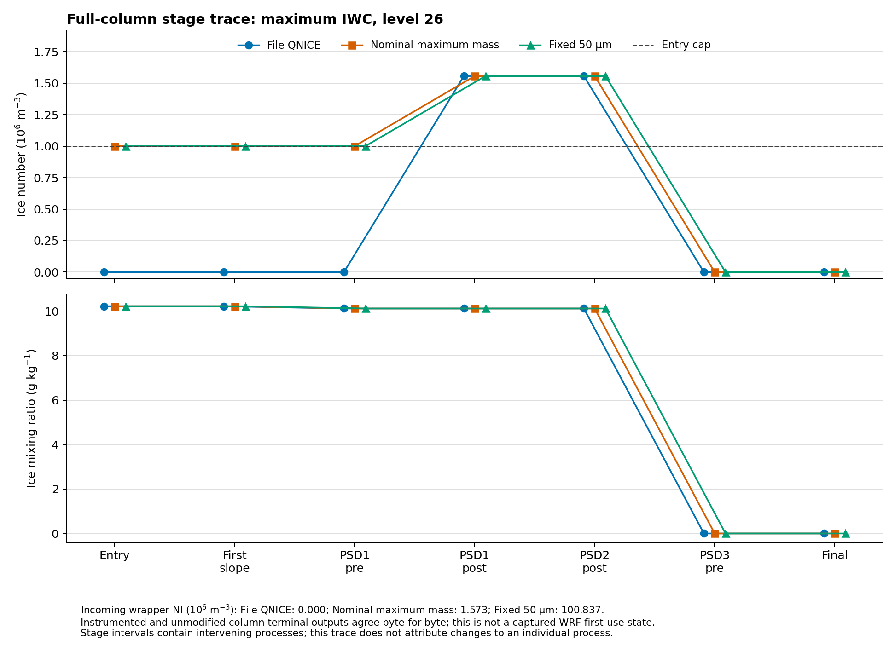

# 빙정 단계별 규약: 그림·수치 자료

[학술 보고서](../../ICE_NUMBER_STAGE_CONTRACT_20261111.md) · [전체 그림·자료 ZIP](all_figures.zip)

## 고정 상태의 연산 합성

QI·DEN을 고정한 cap→첫 slope→PSD1 합성이다. 실제 첫 호출이나 침강·상변화를 포함한 결과가 아니다. 원의 진입 NI와 사각형의 PSD1 NI가 겹치는 경우도 그대로 표시했다. 아래 λ는 기록된 첫 reciprocal slope의 역수인 진단값이다.

[그림 수치](figures/target_levels.csv) · [입력·그림 출처](figures/provenance.json)

## 전체 국지 기둥 호출

최대 IWC 지점 제26층의 NI·QI를 세 입력에서 비교한다. 초기 wrapper 수농도는 축에서 제외했지만 그림 주석과 전체 CSV에 모두 남겼다. 경계 사이의 여러 과정 변화이며 단일 원인 기여량으로 해석하지 않는다. 원본/계측의 최종 배열은 일치했으나 실제 WRF 첫 사용·예보 관측을 뜻하지 않는다.

[전체 목표층 수치](figures/full_column_target_stages.csv) · [출처](figures/full_column_trace_provenance.json)

## 규약과 검증

- [단계별 읽기 전용 규약](contract/policy.json)
- [국지 호출 12,338행](analysis/stage_rows.csv)
- [연산별 NI 저장값 변화](analysis/operator_adjustments.csv)
- [검증 요약](analysis/summary.json)
- [정밀도·재현 검증](validation/receipt.json)

ZIP에는 보고서·두 PNG·수치·주요 검증 자료를 포함하며 PDF는 만들지 않는다. 기존 B1 및 26개 평가 기준을 유지한다.
