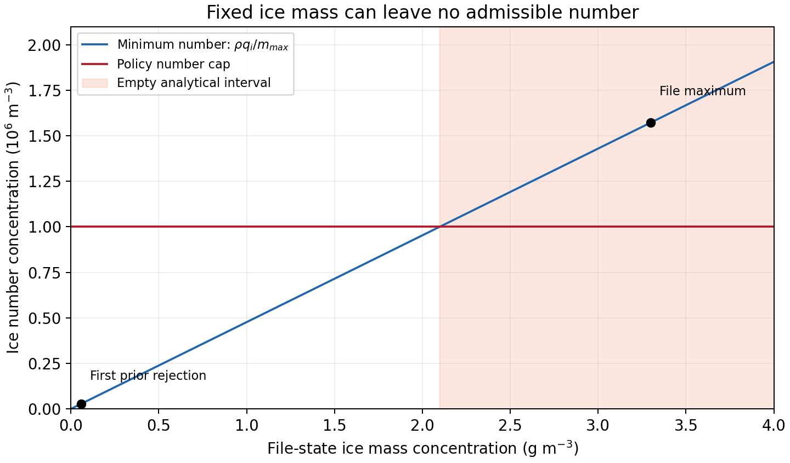

# 모멘트 초기화 허용구간: 그림과 자료

[학술 보고서](../../MOMENT_FEASIBILITY_20261111.md) · [전체 그림·자료 ZIP](all_figures.zip)

파란 선은 현재 고정 질량을 허용 최대 평균 입자질량으로 나눈 최소 수농도다. 빨간 수농도 상한보다 높으면 해석적 허용구간이 빈다. 첫 사전값 거부 셀과 입력 최대값은 서로 다른 상태다. 그림은 고정 정책과 보존 입력의 산술이며 실제 첫 모형 사용이나 예보 결과가 아니다.

- [곡선 수치 CSV](figures/ice_feasibility_curve.csv)
- [전체 실제 B1 재집계·마스크 해시](science/feasibility_recount.json)
- [재집계 방법](science/README.md)
- [상변화·실제 소비 분기 시험](science/phase_consumer.md)
- [고정 소스 검증](validation/validation_receipt.json)

ZIP은 보고서·그림·수치 및 검증 요약을 포함한다. 포함하지 않은 저장소 문서 링크는 연구 브랜치의 웹 링크로 연결하며 PDF는 만들지 않는다. 새 6시간 예보나 점수 변경은 없다.
