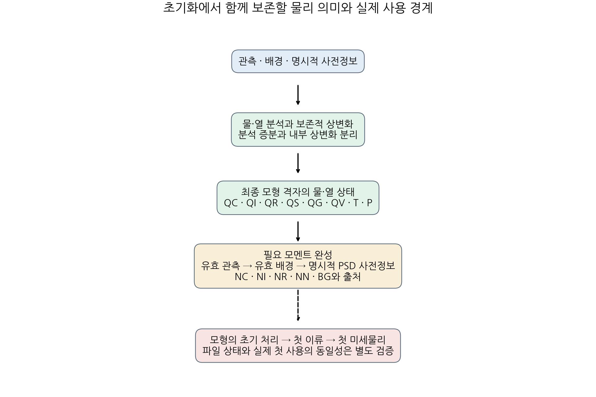
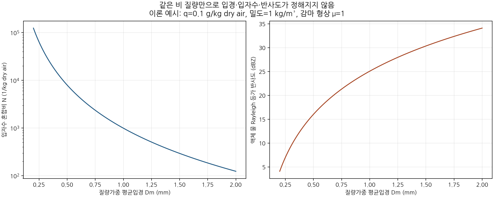

# 물·열·모멘트 초기화: 그림과 자료

[학술 보고서](../../PHYSICAL_MOMENT_INITIALIZATION_20261110.md) · [보고서·그림·핵심 자료 ZIP](report_figures.zip) · [모형 입력 계약](../../MODEL_MOMENT_HANDOFF.md)

새 예보·강수 점수는 없다. 실제 B1 입력에 적용한 고정 사전값은 NI 상한 위반으로 거부됐으며 현재 B1을 유지한다. 그림은 초기화 구조와 이론적 PSD 자유도를 나타낸다.

## 초기화의 물리 경로와 실제 사용 경계

## 같은 비 질량에 가능한 입경·입자수·반사도

관측이나 최적 입경을 뜻하지 않는 이론 예시이다.

[이론 자료 CSV](figures/rain_psd_family.csv) · [실제 생산 재생·초기화 거부 근거](native/actual_real/README.md)
